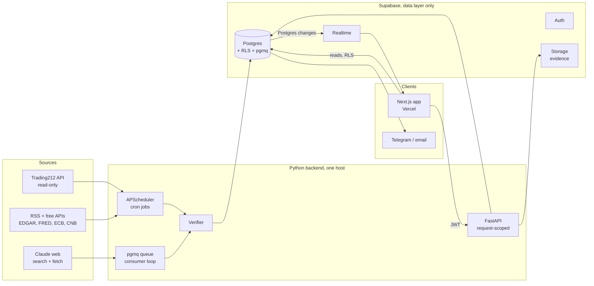
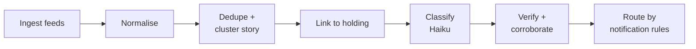
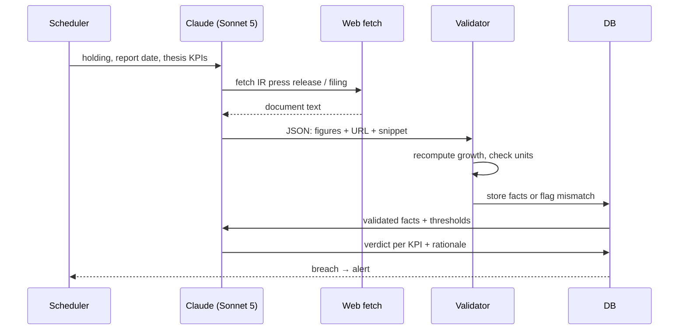

# AI Portfolio Copilot — Technical Product Description

Sep 25, 2026 · @Josef

## Overview

Portfolio Copilot is a single-user, self-hosted app that reads a Trading212 portfolio, stores the owner's investment strategy and per-holding theses, and uses Claude to monitor, explain and research. It substitutes AI web search for paid market data and news wherever the data is qualitative or comes from a primary source, and uses free APIs for the rest.

**Goals**

- One overview of holdings, allocation, drift from target weights and P/L, refreshed daily.
- Automatic checks of each holding's thesis when the company reports, with a pass/breach verdict per KPI and the source of every figure.
- A daily news and macro digest limited to items that touch a holding or the strategy.
- On-demand deep research on any ticker, judged against the written strategy.
- A monthly recommendation review: rule compliance, rebalancing needs, positions whose thesis is weakening.

**Design principle:** anything that expresses a preference is configuration, not code. That covers strategy, theses, news sources, event severities, notification rules, research profiles, schedules, models and budgets. It is edited in the app, versioned, and takes effect on the next run without a deploy.

**Non-goals (v1)**

- No order placement. The Trading212 key is read-only and the code has no write path.
- No real-time prices, intraday data, technical trading signals or options.
- No multi-user support or commercial use. All data licences are personal-use.
- No consensus-estimate comparisons. Theses use absolute KPI thresholds the owner sets.

**Users and access:** one owner, through a web dashboard, email or push alerts, and a chat panel.

## What the app does

Nine capabilities, all reading from and writing to one Supabase database, all governed by the config the owner edits.

**1. Portfolio overview.** Daily sync from Trading212: positions, quantities, average cost, current value, unrealised P/L, cash and dividends. The dashboard shows total value, allocation by holding and by the categories set in the strategy (sector, geography, currency), and each position's drift from its target weight and band. Values convert to the strategy's base currency using ČNB or ECB rates, so FX effects are visible rather than hidden inside Trading212's single-currency figures.

**2. Thesis tracking.** Every holding has a thesis: why it's owned, the KPIs that must hold true, and the conditions that would end it. When a holding reports, the earnings thesis check extracts the relevant figures from the primary source and judges each KPI pass, breach or unknown. The thesis board shows every holding's current status at a glance, with the reasoning and the source behind each verdict one click away.

**3. Continuous news monitoring.** Company, regulatory, macro and central-bank feeds are ingested on a schedule, deduplicated, matched to holdings, classified by event type and severity, and checked for corroboration before anything is treated as confirmed. The News coverage and Defence sections below define exactly what counts as a source and what counts as confirmed.

**4. Alerts and digests.** Severity-3 events (profit warnings, M&A, dividend cuts) reach the owner immediately on the configured channel. Everything else waits for the daily or weekly digest, which groups news by holding, links each item to the relevant thesis KPI where one exists, and adds macro context. Quiet hours, per-ticker muting and a daily alert cap are all configurable.

**5. On-demand deep research.** Any ticker, owned or not, can be researched against the written strategy: business summary, financial trend, moat and risks, valuation computed in code, fit against each strategy rule, and open questions, with every claim linked to a source. Which sections run, how deep, and which source tiers are allowed are set per research profile, so a quick screen and a thorough workup are two different, user-defined modes rather than one fixed shape.

**6. Monthly recommendation review.** A standing check of the whole portfolio against the strategy's rules: position limits, allocation bands, concentration, and any holding whose thesis has weakened. Every proposed action names the rule or KPI it rests on; anything without one is shown as opinion and kept apart. No action is ever taken automatically. The owner confirms every trade in Trading212.

**7. Chat.** A conversational panel for anything not worth a full report: "how exposed am I to EUR?", "what changed on holding X this week?", "re-run the thesis check on Y". Answers cite their sources and can trigger any of the jobs above.

**8. Configuration.** Strategy, theses, holding profiles, news sources, event severities, notification rules, research profiles, job schedules and the spend budget are all editable in the app, versioned, and validated before saving. A change takes effect on the next run; nothing requires a code deploy. The Configuration section below covers this in full.

**9. Transparency and audit.** Every stored figure carries its source URL, its verbatim snippet and a confidence label (Verified, Corroborated, Unconfirmed, Disputed). Every alert, fact and report sentence has feedback buttons that quarantine wrong data and adjust source trust. A job log makes silent monitoring gaps visible, and a cost page shows spend against the configured budget.

## System architecture

Supabase is the data layer only: Postgres, Auth, Storage and Realtime. All logic — collectors, AI jobs, scheduling, verification — lives in a separate Python backend that owns its own deployment and its own connection to the database. Code owns every number the dashboard shows; the AI never supplies a figure without a stored, verified source.



The frontend reads most data straight from Postgres through supabase-js under row-level security. It calls the Python API only for actions: on-demand deep research, chat, config saves, feedback. The Python backend never goes through PostgREST or an Edge Function; it holds a direct connection to Postgres as a dedicated, least-privilege role.

Two processes run from one Python codebase. The **worker** holds an internal APScheduler for every timed job (portfolio sync, digests, quarterly calendar refresh) and a loop that polls the `pgmq` queue in Postgres for event-driven jobs (report date reached, price move, severity-3 cluster, on-demand research and chat requests enqueued by the API). The **API** (FastAPI) serves the frontend's action calls, validates them with Pydantic, and either handles them directly (config save, feedback) or enqueues them for the worker (deep research, chat). Both processes share one package for database access, config schemas, source adapters and the Anthropic client.

**Execution model.** A persistent Python process has no Edge Function-style time limit, so a 20-step deep research runs as one async job rather than 20 chained invocations. Steps are still checkpointed to the `job_step` table after each Claude call — not because a platform forces it, but so a crashed or redeployed worker resumes from the last completed step instead of repeating billed API calls. A **static outbound IP** is a byproduct of a persistent host, which Edge Functions cannot offer; this reopens Trading212 IP allow-listing as an option (see Security).

| Component | Responsibility |
| --- | --- |
| Collectors (Python worker) | Trading212 sync, RSS and API ingestion, FX, macro series, earnings calendars; retries and rate limits |
| Scheduler (APScheduler, in-process) | Cron-style timing for every job in the Jobs config |
| Queue consumer (pgmq, in-process) | Event-driven jobs: earnings checks, escalations, on-demand research and chat |
| AI jobs (Python worker) | Classification, corroboration, extraction, verdicts, digests, research, chat; one Claude call per step, checkpointed |
| API (FastAPI) | Frontend actions: config save/validate, feedback, on-demand triggers; verifies the Supabase Auth JWT on every call |
| Verifier | Schema checks, snippet containment, recomputation, corroboration rules, claim-support check |
| Postgres (Supabase) | Config, portfolio history, facts, news, verdicts, reports, jobs, feedback; RLS for frontend reads |
| Storage (Supabase) | Evidence archive: fetched pages and PDFs behind every stored fact |
| Realtime (Supabase) | Broadcasts Postgres changes (job status, new alerts) to the frontend with no extra backend code |
| Web app (Next.js) | Dashboard, thesis board, news feed, reports, config editor, cost page, feedback buttons |
| Notifier (Python worker) | Telegram and email per notification rules; everything else waits for the digest |

## Data sources

No paid market-data provider in v1. Trading212 supplies holdings and current prices; free public APIs supply US filings, macro series, FX and a US earnings calendar; AI web search and fetch cover news, European company reports and qualitative research.

**Structured sources (code collectors)**

| Source | Data used | Access | Notes |
| --- | --- | --- | --- |
| [Trading212 Public API](https://docs.trading212.com/api) | Positions, avg price, current price, P/L, cash, dividends, order history, instrument metadata, pies | API key + secret, read scopes only | Beta; strict per-endpoint rate limits; values in primary account currency only |
| SEC EDGAR (data.sec.gov) | US company filings, XBRL company facts (revenue, margins, EPS by quarter) | Free, no key; User-Agent header required | US issuers only; primary source |
| FRED | US rates, inflation, yield curve, unemployment | Free API key | Macro context for digests |
| ECB Data Portal | Euro-area rates, HICP inflation | Free, no key | Macro context |
| ČNB daily FX fixing | CZK exchange rates | Free text file | Needed if the account currency is CZK |
| Finnhub free tier | US earnings calendar, basic company profile, company news headlines | Free key, \~60 calls/min, personal use | Verify which endpoints stay free before relying on them |

**AI-substituted data (web search + fetch)**

| Data need | AI method | Reliability | Guardrail |
| --- | --- | --- | --- |
| News per holding | Feed ingestion first; AI search only for corroboration and gaps (see News coverage) | High | Dedupe by URL; keep headline, date, source |
| Macro and central-bank events | Daily search, summarised into the digest | High | Qualitative only; numbers come from FRED/ECB |
| Earnings actuals (EU and US) | Fetch the company's press release or IR page after the report date | High if the source is primary | Extract to JSON with URL and verbatim snippet per figure; validator recomputes |
| Earnings dates for non-US holdings | Quarterly fetch of each company's IR financial calendar page | Medium | Store date + URL; re-check a week before |
| Company profile, moat, competition, risks | Deep-research job | High for qualitative content | Every claim carries a source link |
| Valuation multiples | Computed in code from Trading212 price + extracted fundamentals | Medium | Never taken from third-party sites |

**Not covered in v1:** consensus estimates and standardised cross-company fundamentals for non-US companies. Theses use absolute KPI thresholds, so v1 does not need them. Historical price series for volatility and correlation, originally listed here, are now planned from Stooq (see Additional data sources).

## Additional data sources

Twelve further free sources, added to the plan on 2026-09-25. Each one gets an adapter behind the provider interface, a trust tier, a refresh cadence, and storage of both its normalised fields and its raw payload (for audit and later use). They are implemented end to end: collected, stored, verified, and surfaced in the app (holding page, news feed, digests, research or monthly review), not only fetched. Every field a source provides is either used by a named feature below or stored raw with a stated reason; nothing is dropped silently.

Access was checked from a cloud host on 2026-09-25. OpenFIGI, ESMA FIRDS, GLEIF, Eurostat, Nager.Date, Frankfurter, SEC EDGAR full-text search, Investegate, the LSE news pages and EQS News all responded. Stooq closed the connection, so its availability from the live backend host is an open risk (see Risks). dgap.de now redirects to eqs-news.com (DGAP is today's EQS News), and api.frankfurter.app redirects to api.frankfurter.dev/v1.

**Order matters.** Identity comes first: OpenFIGI, FIRDS and GLEIF turn each Trading212 instrument into a share class, its listings, its issuer's LEI and its home market. News matching, 13F, Stooq symbols and corporate structure all key off those identifiers.

### Identity and reference data

**OpenFIGI** (`api.openfigi.com/v3`, free; an API key raises the rate limit)
- Provides: FIGI (per listing), composite FIGI (per country), share-class FIGI (global), ticker, exchange code, name, market sector, security type and type 2, security description. Endpoints: mapping (ISIN, CUSIP, SEDOL, ticker + exchange code to FIGI), search, filter, and the lists of valid values.
- Used for:
  - Resolving each Trading212 instrument to one share class and all its listings, so a company listed on several exchanges is one holding. An ISIN identifies the security, not the listing.
  - Every listing's ticker goes into the holding's news aliases.
  - The ticker and exchange code derive the Stooq symbol.
  - Mapping 13F positions, which carry only a CUSIP, to holdings.
  - Security type separates common stock, ADRs, ETFs and preferred shares for allocation and classification defaults.
- Stored: `instrument_identifier`. Refresh: on a new instrument, then monthly.

**ESMA FIRDS and FITRS** (ESMA registers API for per-ISIN lookup; daily full and delta XML files for bulk)
- FIRDS provides, per ISIN and trading venue: full name, CFI code, issuer LEI, venue MIC, currency, admission and first-trade date, termination date (debt fields such as maturity are not used; v1 holds no bonds).
- FITRS (the transparency register) provides: liquidity flag, average daily turnover, number of trades, and the most relevant market.
- Used for:
  - The authoritative list of EU venues for each holding.
  - The issuer LEI links to GLEIF.
  - The CFI code sets the instrument class (shares, ETF units, depositary receipts).
  - The most relevant market sets the home market, and so which regulatory news source applies: RNS for UK, EQS for Germany, the national OAM otherwise.
  - A termination date raises a delisting event (severity 2).
  - Liquidity and turnover flag hard-to-trade positions in the monthly review.
- Tier 1 (regulator). Refresh: weekly delta, monthly full check.

**GLEIF Level 1 and Level 2** (`api.gleif.org/api/v1`, no key)
- Level 1 provides: legal name, other and transliterated names, legal and headquarters address, jurisdiction, legal form, entity status and category, registration authority and ID, successor LEI, registration status and next renewal date, and mappings from LEI to ISIN, BIC, MIC and OpenCorporates ID.
- Level 2 provides: direct and ultimate accounting-consolidation parent, direct and ultimate children, the relationship period, status and validation level, and reporting exceptions with their reason (for example "natural persons" or "non-consolidating").
- Used for:
  - Legal and other names go into news aliases.
  - Jurisdiction and headquarters give the default geography classification.
  - Parents and children form the group structure on the holding page.
  - Children's names go into news aliases, so news about a subsidiary reaches the holding.
  - Holdings sharing an ultimate parent are combined in concentration checks.
  - An entity-status change, a successor LEI or a lapsed LEI raises a corporate-event signal.
  - Reporting exceptions are shown as the stated reason no parent is listed.
  - The ISIN mapping cross-checks the OpenFIGI and FIRDS resolution.
- Level 2 describes accounting consolidation, not shareholdings; shareholder data comes from 13F and from voting-rights notices (RNS "Holding(s) in Company", EQS voting-rights announcements). Tier 1. Refresh: weekly (GLEIF publishes a golden copy several times a day).

**Wikidata** (SPARQL at `query.wikidata.org`, CC0, descriptive User-Agent required)
- Provides, for a company:
  - Identifiers: ISIN (P946), LEI (P1278), SEC CIK (P5531), ticker as a qualifier (P249) on stock exchange (P414).
  - Ownership: parent organization (P749), has subsidiary (P355), owned by (P127, with share qualifiers where present), owner of (P1830).
  - Business: industry (P452), products (P1056), country (P17), headquarters (P159), official website (P856), inception (P571).
  - People: founder (P112), CEO (P169), chairperson (P488).
  - Figures: employees (P1128); revenue, net profit and total assets (P2139, P2295, P2403) with point-in-time qualifiers.
  - Index membership, aliases in every language, and sitelinks.
- Used for:
  - Multilingual aliases and former names in the news profile (Czech and German outlets name companies differently).
  - Parent, subsidiary and owner links, cross-checked against GLEIF.
  - Industry plus index membership suggest competitors.
  - Products suggest watch topics.
  - Current CEO and chair help match and verify management-change events.
  - The official website helps find the IR page.
- Wikidata has **no competitor, supplier or customer property**. Competitors are inferred (same industry and index); customers and suppliers come from EDGAR full-text search (below).
- Wikidata is community-edited: its facts are tier 3, and its financial figures are only compared with filing-derived facts as a plausibility check, never shown as data. Relationships from Wikidata alone appear as "suggested" until the owner confirms them into the holding profile or GLEIF or a filing corroborates them.
- Refresh: monthly.

### Prices, FX and calendars

**Stooq** (daily CSV download, `stooq.com/q/d/l/?s=<symbol>&i=d`; unofficial, no key, personal use)
- Provides: daily, weekly and monthly OHLCV (date, open, high, low, close, volume) for equities (`.us`, `.uk`, `.de`, …), indices (e.g. S&P 500, DAX, FTSE 100), FX pairs, commodities and bond yields.
- Used for:
  - Per holding: returns over periods, volatility, maximum drawdown, beta against a configured benchmark, and a correlation matrix across holdings. This closes the v1 gap "historical price series for volatility and correlation".
  - The ±8 % price-move trigger on close-to-close moves, independent of when the sync runs.
  - A benchmark comparison on the Overview.
  - Valuation-multiple history in research.
  - Volume, to flag unusual activity next to news.
  - A plausibility check of Trading212 prices.
- Symbols come from the OpenFIGI ticker and exchange, with a per-holding override in config.
- Tier 2. Refresh: daily after the market close.

**Frankfurter** (`api.frankfurter.dev/v1`, no key)
- Provides: ECB reference rates (latest, by date, and time series over a range) for any base currency, plus the currency list.
- Used for:
  - Backfilling FX history in one request per range, for historical snapshots and performance in the base currency.
  - Fallback when the ECB Data Portal is unreachable, before falling back to stored rates.
  - A daily consistency check against the Data Portal fetch.
- It republishes ECB data, so it adds redundancy, not independent corroboration.

**Nager.Date** (`date.nager.at/api/v3`, no key)
- Provides: public holidays per country and year (date, local and English name, fixed or movable, national or regional with the regions, holiday types), long weekends, the next holidays, and country info.
- Used for, via an expected-gap calendar:
  - No FX-staleness warning when ČNB or ECB publish no rate on a holiday.
  - No missed-run alert for a sync or collector that has nothing to collect.
  - The digest marks market holidays.
  - Earnings dates that fall on holidays are flagged as implausible.
  - Notification rules can treat holidays like weekends.
- Public holidays are not exchange calendars (NYSE closes on Good Friday, which is not a US federal holiday; Xetra and the LSE have their own closures). Nager seeds a per-exchange closure list in config that the owner confirms. Refresh: yearly, plus on demand.

### Regulatory news and filings

**RNS for UK-listed holdings** (the London Stock Exchange's news pages, or Investegate.co.uk)
- Provides, per announcement: time, company and TIDM, headline, announcement type (category), announcement ID, full text, and links to attachments.
- Used for:
  - Layer-1 news for UK holdings.
  - The announcement type maps to the event taxonomy (in the Event rules config).
  - Results and trading-statement announcements trigger the earnings thesis check immediately, instead of at report date + 1.
  - Director and PDMR dealings become insider events.
  - "Holding(s) in Company" notices update the ownership view.
  - Full texts are archived in the `evidence` bucket.
- Neither site offers a documented public API: the LSE pages load their content from a JSON backend, and Investegate serves HTML per company. A spike confirms the terms of use and a stable access method before building; Investegate is the fallback. Tier 1 (issuer disclosures).

**EQS News, formerly DGAP, for German-listed holdings** (`eqs-news.com`)
- Provides: ad-hoc disclosures (Art. 17 MAR), directors' dealings (Art. 19 MAR), voting-rights notifications (§ 40 WpHG), corporate news, financial-report publication notices and AGM invitations, each with issuer, ISIN, time, category and full text (German and English).
- Used for: the same as RNS for German holdings. Ad-hoc disclosures are the main source of severity-3 events (profit warnings). Voting rights update the ownership view.
- Access method (feed or per-issuer pages) confirmed in the same spike. Tier 1.

**SEC EDGAR full-text search** (`efts.sec.gov/LATEST/search-index`, JSON, filings since 2001, User-Agent required, SEC fair-access rate limits)
- Provides, per hit: accession number, CIKs and company names, form type, filing and period dates, and the file within the filing.
- Used for:
  1. **Customers and suppliers:** other companies' 10-K and 20-F filings that name a holding, e.g. as a key supplier or major customer, become relationship suggestions with the filing as the source.
  2. **Competitors:** the holding's own 10-K Competition section and rivals' filings that name it.
  3. **Watch topics:** each topic in the holding profiles runs as a saved search over new 8-K, 6-K, 10-Q and 10-K filings; new hits enter the news pipeline as tier-1 items.
  4. **Risk terms:** a watched term appearing for the first time in a holding's filings becomes a digest highlight.
- Refresh: with the news ingest, 06:00–22:00, every 2 h.

**Form 13F** (13F-HR filings on EDGAR; SEC quarterly Form 13F data sets for bulk loading)
- Provides, per manager and quarter: filer CIK and name, report period, and per position the issuer name, title of class, CUSIP, value, shares or principal amount, put/call, investment discretion, other managers, and voting authority (sole, shared, none).
- Used for, per US-listed holding:
  - Number of institutional holders, total shares held, quarter-over-quarter change, top holders, and new and exited positions, shown on the holding page and in the research ownership section.
  - Crowding and concentration signals in the monthly review.
  - An optional "tracked managers" list in config, whose new and exited positions matching the portfolio or a watchlist appear in the digest.
- Limits: filed up to 45 days after quarter end; covers only 13(f) securities of managers above USD 100 M; positions are matched by CUSIP through OpenFIGI; the value unit changed from thousands of dollars to dollars in 2023 and is normalised. Refresh: quarterly after the filing deadline.

### Macro

**Eurostat** (dissemination API, JSON-stat 2.0 and SDMX; no key; release calendar)
- Provides: HICP (flash and final, by category), unemployment, GDP and components, industrial production, retail trade, producer prices, business and consumer confidence, trade and government finance, per country and aggregate (CZ, DE, euro area, EU), plus release dates.
- Used for:
  - `macro_series` straight from the primary source, including Czech series.
  - Macro-surprise detection: evaluated only on release days, comparing the new value with the previous one and the configured band.
  - Digests cite the release date and the source URL.
- The probe found `prc_hicp_manr` last updated in February 2026, consistent with HICP moving to COICOP 2018 datasets; confirm dataset codes when implementing. Tier 1. Refresh: on release days from the calendar.

## News coverage

News comes in three layers. Primary-source feeds are ingested by code for free. Curated outlets are read through RSS and free APIs. AI web search is used last: to corroborate claims and fill gaps, not as the main feed. Every item is classified into a fixed event taxonomy and routed by the notification rules.

**Layer 1: primary sources (trust tier 1)**

| Source | Events it carries | Access | Scope |
| --- | --- | --- | --- |
| Company IR news and press-release pages | Results, guidance, dividends, buybacks, M&A, management changes | RSS where offered, else daily page fetch + diff; URL per holding in config | All holdings |
| RNS (London Stock Exchange news pages or Investegate) | Results, trading statements, PDMR dealings, holdings in company, all UK regulatory announcements | Per-company pages; access method confirmed in a spike (no documented public API) | UK-listed holdings |
| EQS News (formerly DGAP) | Ad-hoc disclosures (Art. 17 MAR), directors' dealings (Art. 19 MAR), voting rights (§ 40 WpHG), corporate news | eqs-news.com feed or per-issuer pages | German-listed holdings |
| Other EU regulatory announcements (MAR ad-hoc disclosures, managers' transactions) | Inside information, profit warnings, insider dealings | The issuer's regulatory-news page; the home country's officially appointed mechanism (OAM) as fallback | EU-listed holdings outside the UK and Germany (home market from FIRDS) |
| SEC EDGAR company filing feeds | 8-K (material events; item 2.02 = results), 10-Q, 10-K, Form 4 insider trades, SC 13D/G stakes | Atom feed per CIK, no key | US issuers |
| SEC EDGAR full-text search | Watch-topic and name mentions in any filing: customers, suppliers, competitors, new risk terms | Saved searches on efts.sec.gov, no key | All holdings (mentions in US filings) |
| Newswires: GlobeNewswire, PR Newswire, Business Wire | Official press releases as distributed | RSS by company or keyword where available | Mostly US and larger EU issuers |
| Central banks: Fed, ECB, ČNB | Rate decisions, statements, meeting calendars | Official press pages and RSS | Macro |
| Statistics offices: BLS, BEA, Eurostat, ČSÚ | CPI, jobs, GDP, PCE, HICP release values | Release calendars; US values via FRED, EU and Czech values direct from the Eurostat API | Macro |

**Layer 2: curated outlets (trust tier 2)**

| Source | Use | Access |
| --- | --- | --- |
| Reuters, AP, CNBC, MarketWatch | Fast reporting of company and macro events | RSS where available; web search restricted to these domains |
| Financial Times, Bloomberg, WSJ | Headline and date only (paywalled); must be confirmed elsewhere before alerting | RSS headlines; never fetched in full |
| Finnhub company news | US ticker-tagged headlines | Free API |
| Hospodářské noviny, E15, Seznam Zprávy | Czech macro and Czech-listed holdings | RSS or web search |
| Google News RSS query per holding | Broad discovery of anything the feeds above missed | Query built from the holding's aliases; off by default (unofficial endpoint) |

**Layer 3: excluded by default (trust tier 3):** Seeking Alpha contributor posts, blogs, Reddit, X. If enabled, items are labelled "sentiment" and never trigger an alert on their own.

**Event taxonomy (default severities, all editable)**

| Event type | Examples | Default severity | Default action |
| --- | --- | --- | --- |
| Profit warning / guidance change | Guidance cut or raised, pre-announcement | 3 | Instant alert + thesis check |
| M&A | Acquirer, target, merger talks confirmed | 3 | Instant alert |
| Dividend cut or suspension | Board announcement | 3 | Instant alert |
| Earnings release | Quarterly or annual results | 2 | Earnings thesis check |
| Management change | CEO or CFO departure or appointment | 2 | Digest highlight |
| Regulatory or legal | Investigation, fine, ruling, license loss | 2 | Digest highlight; 3 if the thesis names it |
| Capital allocation | Buyback, dividend raise, share issuance | 2 | Digest highlight |
| Credit rating change | Upgrade or downgrade | 2 | Digest highlight |
| Central bank decision | Rate change or guidance shift | 2 | Digest highlight |
| Macro surprise | CPI, jobs or GDP beyond the configured surprise band | 2 | Digest highlight |
| Insider transactions | Form 4, MAR managers' transactions | 1; 2 for cluster buying or selling | Digest |
| Product or business | Major contract, launch, recall | 1 | Digest |
| Sector or competitor event | Event at a named competitor, supplier or customer | 1 | Digest |
| Index change | Inclusion or exclusion | 1 | Digest |
| Analyst rating or price target | Upgrades, downgrades, targets | 0 | Ignored unless enabled |

Severity 0 = ignored, 1 = digest, 2 = digest highlight linked to the thesis, 3 = instant alert.

**Processing pipeline**



1. **Ingest:** feeds run every 2 hours from 06:00 to 22:00 CET (configurable). Items older than the freshness window (default 72 h) are dropped.
2. **Normalise:** canonical URL, source, tier, published time, language.
3. **Dedupe and cluster:** exact URL match, then near-duplicate headline matching. Syndicated copies of one wire story form one cluster and count as one source.
4. **Link:** match to holdings through aliases, tickers and ISINs from each holding's news profile. Unmatched items are dropped.
5. **Classify:** Haiku labels event type, affected holding, related thesis KPI, rumour language and confidence, 50 items per call.
6. **Verify:** the corroboration rules in "Defence against wrong information" decide confirmed, unconfirmed or disputed.
7. **Route:** severity, holding and event type map to a channel under the notification rules.

**Per-holding news profile (config):** aliases and former names, ticker and ISIN variants, IR and regulatory-news URLs, named competitors, suppliers and customers, watch topics (for example "EU chip export controls"), exposures (revenue by currency, key commodity inputs). The profile decides what counts as relevant, so a news item about a key supplier reaches you even when your holding is not mentioned.

**Expected volume:** for 15 holdings, roughly 50–150 raw items a day, 30–80 after dedupe and linking, and 0–5 items at severity 2 or above on a normal day. These are estimates to replace with measured counts after the first two weeks.

## AI pipelines

Nine AI jobs plus two code-only jobs. Each has a model, a tool allowance, a step cap and a JSON output schema. Cheap models filter; stronger models judge only what passes the filter. Every trigger, model and cap below is a default read from config.

| Job | Trigger | Model | Tools | Cap | Output |
| --- | --- | --- | --- | --- | --- |
| Portfolio sync | Daily 22:30 CET | None (code) | Trading212 API | n/a | Positions snapshot, drift vs targets |
| News ingest | Every 2 h, 06:00–22:00 CET | None (code) | RSS, EDGAR feeds, Finnhub | n/a | Normalised, deduped items |
| News classification | After each ingest | Haiku 4.5 | None | 50 items per call | Event type, holding, KPI link, severity, rumour flag |
| Corroboration | Severity ≥ 2 from tier 2 or 3 | Haiku 4.5 | Web search (allowed domains) | 3 searches | Confirmed, unconfirmed or disputed |
| Event escalation | Confirmed severity ≥ 2 | Sonnet 5 | Web search, fetch | 5 steps | Impact note linked to thesis |
| Earnings thesis check | Report date reached | Sonnet 5 | Fetch (primary sources, PDFs), EDGAR | 8 steps | Extracted KPIs + verdict per KPI |
| Claim verifier | Before any AI text is published | Haiku 4.5 | None | 1 call | Supported or unsupported per sentence |
| Daily digest | Configured time, default 07:00 CET | Sonnet 5, Batch API | None (reads DB) | 1 call | Digest + alert list |
| Deep research | On demand | Per research profile, default Opus 5.5 | Search, fetch, EDGAR | Per profile, default 20 steps | Research report with sources |
| Monthly review | 1st weekday of month | Opus 5.5 | None (reads DB) | 3 steps | Compliance table + proposed actions |
| Chat | User message | Sonnet 5 | DB queries, search, fetch | 6 steps | Answer with sources |

**Earnings thesis check (core flow)**



The extraction and the verdict are two separate calls. The verdict call sees only validated figures, never the raw page, so a prompt injection in a press release cannot reach the judgement step.

**Extraction schema (per figure)**

```json
{
  "ticker": "ASML",
  "period": "Q3 2026",
  "metric": "revenue",
  "value": 7.52,
  "unit": "EUR bn",
  "basis": "reported",
  "source_url": "https://...",
  "source_snippet": "verbatim sentence containing the figure"
}
```

The figures in the example are placeholders. The validator rejects any figure whose snippet does not contain the value as written.

**Deep research** runs as a chain of steps under a research profile chosen at launch (see Configuration). The profile sets the sections, depth, model, search budget, allowed source tiers and output language. Valuation figures are always computed in code, never written by the model, and every claim links to a stored source.

## Configuration

Every preference lives in versioned config records in Supabase, edited in a settings UI. The Python backend validates every config write with a Pydantic schema; that schema is also exported as JSON Schema, and `openapi-typescript` generates the matching TypeScript types the config editor's forms use, so both sides check against the same source of truth without hand-syncing two schema languages. Jobs read the active config at start and store its version on everything they produce. A change applies from the next run; no deploy is needed.

| Config domain | What you control |
| --- | --- |
| Strategy | Goals, horizon, risk limits, target allocation with bands, position limits, structured rules the code evaluates, free-text notes the AI reads |
| Theses | Per holding: KPIs, operator, threshold, basis (reported or adjusted), exit conditions, review date |
| Holding profiles | Aliases, IR and regulatory-news URLs, competitors, suppliers, customers, watch topics, exposures |
| News sources | Source registry: name, tier, type (RSS, API, page, search), URL, enabled, per-holding scope; domain allow and block lists; freshness window; tier-3 handling |
| Event rules | Severity per event type, per-holding overrides, price-move and macro-surprise thresholds |
| Notifications | Channel per severity, quiet hours and time zone, digest time, daily alert cap, muted tickers or event types, repeat-event throttling |
| Research profiles | Sections, depth, model, search and step budget, allowed source tiers, peers on or off, valuation methods, output language (CZ or EN) |
| Verification | Corroboration rules per tier, sanity bounds per metric, claim-verifier strictness |
| Jobs | Schedule, enabled, model, step cap per job |
| Budget | Monthly cap, per-job caps, behaviour at the cap (downgrade model, pause non-critical jobs) |

**Examples (JSON, as stored)**

```json
{
  "strategy_rule": {
    "id": "max-single-position",
    "type": "position_weight",
    "operator": "<=",
    "value": 0.10,
    "on_breach": "severity_2"
  },
  "notification_rule": {
    "match": { "severity": [3], "event_type": "*" },
    "channels": ["telegram"],
    "quiet_hours": { "from": "22:00", "to": "07:00", "tz": "Europe/Prague" },
    "during_quiet_hours": "hold_until_end"
  },
  "research_profile": {
    "name": "standard",
    "model": "claude-opus-5-5",
    "max_steps": 20,
    "max_searches": 15,
    "source_tiers": [1, 2],
    "sections": ["business", "financial_trend", "moat_risks", "valuation", "strategy_fit", "open_questions"],
    "include_peers": true,
    "language": "en"
  }
}
```

**Versioning and safety**

- Each save creates a new `config_version` row with a diff against the previous one; rollback is one click.
- Invalid config is rejected at save time by the backend's Pydantic schema (the frontend's generated types catch most errors before sending), never at run time.
- **Replay preview:** before saving event or notification changes, the app re-runs the last 7 days of classified items against the draft config and shows which alerts would have fired. This uses stored results only, so it costs nothing.
- Export and import as a JSON file, so config can also be kept in git.
- Strategy and thesis changes never rewrite history: old verdicts stay tied to the version they were judged under.

## Data model

Supabase Postgres, one schema, migrations kept in git and applied with the Supabase CLI. Row-level security is on for every table for the `anon`/`authenticated` roles the frontend uses. The Python backend connects with a separate, dedicated Postgres role (`app_backend`) over a direct connection, with table-level grants and no RLS applied to it — RLS protects the frontend's path, not the backend's.

| Table | Key fields | Written by |
| --- | --- | --- |
| `config_version` | id, domain, body (JSON), schema\_version, diff, created\_at, active | Owner via UI |
| `instrument` | t212\_ticker, isin, name, exchange, currency, cik (US), next\_report\_date, report\_date\_source | Collector + AI |
| `position_snapshot` | date, ticker, quantity, avg\_price, current\_price, value, ppl, weight | Collector |
| `transaction` | id, type (order, dividend, cash), ticker, amount, date | Collector |
| `macro_series` | series\_id, source, date, value | Collector |
| `source` | id, name, tier, type, url, enabled, trust\_score | Owner + feedback loop |
| `news_item` | url (unique), source\_id, published\_at, headline, summary, language, cluster\_id | Collector |
| `story_cluster` | id, holding, event\_type, severity, status (confirmed, unconfirmed, disputed), source\_count, first\_seen | AI + verifier |
| `fact` | ticker, period, metric, value, unit, basis, source\_url, snippet, evidence\_path, status (verified, unverified, quarantined), extracted\_at | AI + verifier |
| `claim` | report\_id, sentence, cited\_fact\_ids, cited\_urls, supported (bool), checker\_note | Claim verifier |
| `verdict` | ticker, period, kpi, status (pass, breach, unknown), rationale, config\_version\_id, fact\_ids | AI |
| `report` | type (digest, research, review, escalation), ticker, body\_md, profile, config\_version\_id, created\_at | AI |
| `alert` | severity, ticker, cluster\_id, message, channel, sent\_at, suppressed\_reason | Notifier |
| `feedback` | target\_type, target\_id, verdict (wrong, irrelevant, useful), note, created\_at | Owner via UI |
| `job` / `job_step` | job type, status, config\_version\_id, step index, model, input\_tokens, output\_tokens, searches, cost\_usd, error | Scheduler + workers |
| `instrument_identifier` | ticker, figi, composite\_figi, share\_class\_figi, exch\_code, security\_type, security\_type2, market\_sector, cusip, source, raw, fetched\_at | Collector (OpenFIGI) |
| `listing` | isin, mic, full\_name, cfi, currency, issuer\_lei, admitted\_at, first\_trade\_at, terminated\_at, most\_relevant\_market, liquid, avg\_daily\_turnover | Collector (FIRDS, FITRS) |
| `legal_entity` | lei, legal\_name, other\_names, jurisdiction, legal\_form, hq\_address, legal\_address, status, successor\_lei, registration\_status, next\_renewal, raw | Collector (GLEIF L1) |
| `entity_relationship` | subject, object, type (parent, ultimate\_parent, subsidiary, owner, competitor, supplier, customer), source (gleif, wikidata, edgar, owner), source\_ref, as\_of, status (confirmed, suggested, rejected), exception\_reason | Collector + owner |
| `price_bar` | symbol, date, open, high, low, close, volume, source | Collector (Stooq) |
| `holiday` | country or mic, date, name, scope (national, regional, exchange), source | Collector (Nager.Date) + owner |
| `institutional_holding` | quarter, filer\_cik, filer\_name, cusip, ticker, value\_usd, shares, put\_call, discretion, voting\_sole, voting\_shared, voting\_none, accession | Collector (13F) |
| `filing_hit` | query\_id, accession, cik, form, filed\_at, file, matched\_term | Collector (EDGAR full-text search) |
| Storage bucket `evidence` | Raw fetched pages and PDFs, keyed by hash | Workers |

`job_step` makes silent misses visible: a holding with no successful news or earnings run in its expected window raises its own alert. The `evidence` bucket means every stored figure can be traced back to the exact page it came from, even after the website changes.

## Scheduling and triggers

Event triggers do the expensive work; timed jobs stay cheap. Outside earnings season the daily AI bill is mostly the news triage.

| Trigger | Condition | Action |
| --- | --- | --- |
| Daily 07:00 CET | Weekday | News triage → escalations → daily digest |
| Daily 22:30 CET | Every day by default; the Jobs config can limit it to weekdays | Trading212 sync, FX, macro series; drift check |
| Weekly, Sunday | Always | Weekly digest; refresh `next_report_date` for holdings due in the next 14 days |
| Quarterly | 1st day of Jan, Apr, Jul, Oct | Fetch IR financial calendars for non-US holdings |
| Report date + 1 day | Holding reported | Earnings thesis check; retry at +2 and +4 days if no document found |
| Drift | Weight outside target band | Flag in next digest; alert if above the hard limit |
| Price move | Daily change beyond ±8% (configurable) | Event escalation for that holding |
| Monthly, 1st weekday | Always | Monthly recommendation review |
| Missed run | No successful run for a holding in its window | Alert: monitoring gap |

All times and thresholds above are defaults from the Jobs and Event rules config. APScheduler, running inside the Python worker process, reads which jobs are due and runs them; `pgmq`, a Postgres extension, holds the event-driven queue, and the same worker polls it in a loop. A job-type lock (a Postgres advisory lock, held for the job's duration) prevents a slow run from overlapping the next one. Event triggers (report date reached, price move, severity-3 cluster) enqueue jobs into `pgmq` the same way the API does for on-demand requests.

## Defence against wrong information

Every external input is a claim to verify, not a fact. Seven layers stop wrong news, wrong numbers and unsupported AI statements before they reach a verdict or an alert. Each layer's thresholds are in the Verification config.

**1. Source trust.** Every source has a tier and a trust score. Tier 1 (the company, regulators, central banks, statistics offices) can confirm a claim alone. Tier 2 outlets need corroboration for material claims. Tier 3 never triggers anything by itself. Owner feedback lowers the trust score of a source that was wrong.

**2. Corroboration rules for news.**

| Claim situation | Status | What happens |
| --- | --- | --- |
| Tier-1 source states it | Confirmed | Routed normally |
| 2+ independent tier-2 outlets (different clusters, not the same wire copy) | Confirmed | Routed normally |
| 1 tier-2 outlet only | Unconfirmed | Digest only, labelled; corroboration search runs; re-checked for 48 h |
| Rumour language ("reportedly", "people familiar", "in talks") | Unconfirmed | Never an instant alert, whatever the severity |
| Sources contradict each other | Disputed | Both versions shown side by side; no verdict changes until resolved |
| Tier 3 only | Sentiment | Shown only if enabled |

**3. Numeric validation.** Runs in code before any figure is stored as verified.

- **Snippet containment:** the verbatim snippet must contain the value as written, and the source page is archived in Storage.
- **Recomputation:** growth rates, margins and ratios are recomputed from raw figures; the model's own arithmetic is discarded.
- **Unit, scale and currency:** millions vs billions, EUR vs USD, and per-share vs total are checked against the report's own stated units.
- **Period alignment:** fiscal quarter labels are mapped to calendar months per company, so "Q3" is not compared across different periods.
- **Cross-source reconciliation:** for US issuers, figures from a press release are checked against the later 10-Q XBRL data; a mismatch quarantines the fact.
- **Sanity bounds:** a change beyond a configured band (default ±50% quarter on quarter) holds the fact for owner review.
- **Restatements:** a new value for an already stored period is kept alongside the old one and flagged, never silently overwritten.

**4. AI output checks.**

- Anything stored is structured JSON validated against a schema. Free text only appears in reports.
- The model is never asked for a figure from memory, and "unknown" is always an allowed answer.
- The current date and each source's publish date are passed into every prompt.
- **Claim verifier:** before a report, digest or alert is published, a separate Haiku call checks each factual sentence against the snippet it cites. Unsupported sentences are removed, or kept and marked, per config.
- Extraction and judgement are separate calls; judgement calls never see raw web pages.

**5. Time checks.**

- Items older than the freshness window are dropped.
- The event date is compared with the publish date, so recycled old stories are not treated as new.
- New items are matched against stored clusters, so an event already known does not alert twice.

**6. Human feedback loop.** Every alert, fact, verdict and report sentence has *wrong*, *irrelevant* and *useful* buttons.

- A fact marked wrong is quarantined, and the verdicts that used it are recomputed.
- The source's trust score drops.
- A weekly error report lists what was flagged and why.
- Owner overrides always win.

**7. Evaluation sets.**

- A golden set of 20–30 past earnings releases for your holdings, with hand-checked figures, reruns on every prompt, model or schema change. Target: at least 98% exact match. A drop blocks the release.
- About 100 labelled news items test classification and routing.
- Both sets grow from items flagged as wrong.

**Confidence labels in the UI:** Verified (tier 1 or validated figure), Corroborated, Unconfirmed, Disputed. A label is shown on every fact, news item and report claim.

## Safety, security and cost guardrails

Accuracy controls are in the section above. This section covers how recommendations are framed, how keys and data are protected, and how spend is capped.

**Recommendation discipline**

- Recommendations are framed as rule compliance: which rule is breached, what action restores compliance, what the thesis says.
- Every proposed action cites the strategy rule or thesis KPI it rests on. An action with no citable rule is shown as "opinion" and kept apart.
- The owner confirms every trade manually in Trading212.

**Security**

- The Trading212 key has read scopes only. The client exposes GET only; order endpoints are absent from the code.
- The Trading212 and Anthropic keys, and the `app_backend` Postgres connection string, are environment variables on the Python host, set through its secrets manager. They never reach the browser or a prompt, and logs scrub them.
- The frontend uses Supabase Auth with a single allowed user plus MFA, and the anon key with row-level security. Its calls to the Python API carry the Supabase JWT, which the API verifies against Supabase's JWKS before handling the request — the backend never re-implements auth, it just checks the same token.
- Fetched web content is untrusted data. Extraction runs in its own call with fetch only; judgement calls never see raw pages.
- **Trading212 IP allow-listing is available again.** A persistent Python host has a static outbound IP (directly, or through a provider's static-IP or dedicated-IPv4 add-on), unlike the Edge Functions this design used earlier. Set it on the Trading212 key once the host is fixed.
- Postgres access: the `app_backend` role is scoped to exactly the tables and functions it needs, with no superuser or `postgres` role in application code.

**Cost control**

- Step and search caps per job, `max_content_tokens` on every fetch, and a monthly spend limit in the Anthropic Console, all set in the Budget config.
- `job_step` logs tokens, searches and cost per step; the app shows month-to-date spend against the budget, and the budget rules downgrade or pause non-critical jobs at the cap.

## Tech stack and hosting

Two codebases, one contract. The Python backend (FastAPI + worker) owns all logic and talks to Postgres directly; the Next.js frontend reads most data straight from Supabase and calls the Python API for actions. FastAPI's auto-generated OpenAPI spec is the contract between them: `openapi-typescript` turns it into the TypeScript types and a typed client the frontend uses, so the two languages stay in sync without a hand-shared package.

| Layer | Choice | Reason |
| --- | --- | --- |
| Frontend | Next.js (App Router), TypeScript, Tailwind, shadcn/ui, Recharts | Mature ecosystem; fast dashboard building |
| Frontend hosting | Vercel free tier | Zero cost for a single user |
| Backend language | Python 3.12 | Best fit for the Anthropic SDK, data and PDF handling, and the wider Python data-science ecosystem |
| Backend API | FastAPI, Pydantic v2, `uv` for dependency management | Async, typed request/response models, auto-generated OpenAPI spec |
| Backend worker | Same codebase, separate entrypoint; APScheduler for cron, an async loop polling `pgmq` for events | One deployable, two processes, sharing all business logic |
| Frontend↔backend contract | OpenAPI spec exported from FastAPI; `openapi-typescript` generates types and a client for Next.js | No hand-maintained duplicate schema between Python and TypeScript |
| Database access | `asyncpg` (or SQLAlchemy 2.0 async) over a direct Postgres connection, as `app_backend` | A persistent process suits a direct connection, not a serverless pooler |
| Migrations | Supabase CLI, plain SQL, one migrations folder | One migration tool for the one schema; the Python backend has no ORM-managed migrations |
| Database (data layer) | Supabase Postgres with row-level security | Config, facts, news, jobs in one place; RLS scopes the frontend's direct reads |
| Auth | Supabase Auth, single user, MFA, sign-up disabled; FastAPI verifies the Supabase JWT via JWKS | No custom auth code, and the backend trusts the same identity as the frontend |
| Files | Supabase Storage, `evidence` bucket, written by the Python backend via the Storage REST API | Archive of every page and PDF behind a stored fact |
| Live updates | Supabase Realtime (Postgres Changes) | The frontend gets job status and new alerts straight from Postgres writes, no backend push code needed |
| Queue | `pgmq`, a Postgres extension, consumed by the Python worker over SQL | No separate broker (Redis, RabbitMQ) to run and pay for |
| AI | Anthropic Python SDK; web search and web fetch server tools with allowed/blocked domains from config; Batch API for digests | No scraping infrastructure |
| PDFs | Sent to Claude as document input | No PDF parser needed, and no execution-time pressure now that the backend is a persistent process |
| RSS | `feedparser` | Standard, well-maintained Python feed parsing |
| Notifications | Telegram Bot API; email through an HTTP email API such as Resend, via `httpx` | Both reachable over plain HTTPS from a Python process |
| Backend hosting | A small always-on host running the API and worker processes — see Backend hosting options below | Needs to be persistent for the scheduler and the queue consumer, and benefits from a static IP |
| Repo | One git repo: `apps/web` (Next.js), `apps/backend` (Python), `supabase/migrations` | Single source of truth for the DB schema; each app keeps its own dependency manifest |
| Testing and CI | pytest for the backend (validators, rules, evals); Vitest for the frontend; GitHub Actions runs both | Evals gate every prompt or model change |

**Backend hosting options**

| Option | Cost (one small instance) | Notes |
| --- | --- | --- |
| Hetzner Cloud VPS (CX22, Falkenstein) | \~$5–6/mo | Static IPv4 included by default; run the API and worker as two systemd services or a Docker Compose stack; the operator does the patching |
| Fly.io | \~$2–10/mo (shared-cpu-1x, 256 MB–1 GB, billed per second) | `fly deploy` from a Dockerfile; dedicated IPv4 is a $2/mo add-on; simplest path from a laptop to a running service |
| Railway | \~$5–20/mo, usage-based | Similar convenience to Fly.io; a static IP typically needs a paid add-on |

A Prague-based, EU-region VPS (Hetzner) keeps latency to Supabase's EU region low and gives a static IP with no extra add-on, which is the simplest path to Trading212 IP allow-listing. Fly.io is the lower-effort alternative if the CLI-driven deploy flow matters more than a few dollars a month.

**Supabase plan:** Free projects [pause after one week of inactivity and have no automatic backups](https://supabase.com/pricing), so use Free for development only. Run the live system on Pro, from $25 a month, which never pauses and keeps daily backups for 7 days. The Python backend connects to Supabase Postgres with a [direct connection](https://supabase.com/docs/guides/database/connecting-to-postgres) (suited to a persistent process), not the serverless-oriented pooler.

**Provider adapter:** all data access goes through one Python interface (`get_positions`, `get_filings`, `get_earnings_calendar`, `get_news`, `get_macro`, and, from phase 2b, `resolve_identity`, `get_reference_data`, `get_relationships`, `get_price_history`, `get_fx_history`, `get_holidays`, `search_filings`, `get_institutional_holdings`). Swapping a free source for a paid one later changes one adapter module.

## Design and UI

This is a data-dense, single-user tool where the main job of the interface is to let the owner trust or distrust a number quickly. The direction below follows current fintech dashboard practice: visual calm, restrained color, and AI output that shows its evidence rather than asserting it.

**Visual language**

- **Light by default, with a dark variant.** The base theme is light — clean surfaces, dark text, restrained borders — since that reads as the more approachable, less "trading terminal" register for a personal tool checked casually through the day. A dark theme is available and switches by system preference or a manual toggle. Both are first-class: the same CSS variable tokens (surface, border, text, gain, loss, accent) are defined for each, so nothing is designed for one theme and patched for the other.
- **Color means one thing: financial state.** Green and red are reserved for gains, losses and pass/breach. Severity and confidence use a separate, muted palette (grey, amber, blue) so the two systems never collide on one card.
- **Tabular (monospaced) numerals** for every price, percentage and currency figure, right-aligned in columns, one or two decimal places. This is a specific, checkable rule: numbers must compare by digit position, not just "look aligned."
- **One accent color** for primary actions and links; everything else stays neutral. A dashboard that colors everything trains the eye to ignore color, which is the opposite of what a portfolio tool needs when something actually breaks.
- **Explicit freshness on every data surface:** a small "as of HH:MM" or "synced 4 min ago" label on the portfolio view, the news feed and every report, because a stale number shown as current is worse than an absent one.

**AI-trust patterns (ties into the Defence section)**

The interface for AI-derived content follows patterns now standard for high-stakes AI products (financial and legal use is explicitly the case for claim-level, not paragraph-level, citation):

- **Confidence badge** on every fact, news item and report claim, using the same four labels as the Defence section: Verified, Corroborated, Unconfirmed, Disputed. Grey/blue/amber/red, placed right next to the claim, never as a global banner.
- **Claim-level citations**, not end-of-report footnote dumps: each sentence that states a figure or event links to the source that supports it, with a hover preview of the snippet and the source's tier.
- **Source card sidebar** on research reports and digests, listing every source used, its tier and its trust score.
- **No fake precision.** No invented "87% confident" scores; confidence is the four-state label above, backed by the corroboration rule that produced it, never a number the model made up.
- **Visible degradation.** A KPI with no verified figure shows "unknown," styled distinctly from pass or breach, never silently omitted.
- **Inline feedback:** a small wrong / irrelevant / useful control sits on every fact, alert and report claim, not buried in a settings page.

**Information architecture**

| Section | Purpose |
| --- | --- |
| Overview | Portfolio value, allocation, drift, today's alerts at a glance |
| Holdings | One row per position; opens to a holding page with its thesis, verdict history, news and evidence |
| News | Filterable feed: by holding, severity, confidence, source tier |
| Research | Past reports plus a "research this ticker" action with profile choice |
| Reports | Digest archive, monthly reviews, searchable |
| Chat | Persistent panel, reachable from anywhere via a command palette |
| Config | Strategy, theses, sources, notifications, research profiles, schedules, budget |
| Activity | Job log, coverage gaps, cost against budget |

- **Command palette (Cmd/Ctrl+K)** for jumping to a holding, re-running a check, or opening a config section without navigating menus. This is now a standard pattern for information-dense, single-user tools, and fits a product with one user who will use it daily.
- **A holding page, not just a table row,** is the core unit of the product: current position, thesis and KPI history, every verdict with its evidence, linked news, and a "research again" button all in one place.
- **Drill-down over dashboards-as-posters.** The overview stays to one screen; anything that needs more room (a KPI's full history, a report's full source list) opens on click rather than being cramped into the summary view.

**Component stack**

- **Tremor** for charts, KPI cards, trackers and data bars — a copy-paste, Tailwind and Radix based library built specifically for metrics UIs, with sparklines and donut/area charts suited to allocation and performance views.
- **shadcn/ui** for forms, dialogs, command palette, tables and navigation. Tremor and shadcn/ui share the same Tailwind and Radix foundation and are commonly used together, so the two component sets look native to each other rather than bolted on.
- **Recharts** underlies both, so custom charts (KPI trend lines, drift-over-time) extend the same primitives instead of a second charting library.
- Both libraries are copy-paste: the code lives in the repo, not behind an npm black box, which matters for a spec that will change as the app grows.

**Mobile and access**

- The dashboard is responsive down to phone width for occasional checks, but the primary mobile surface is Telegram and email alerts, not a mobile-optimised app. A single-user financial tool doesn't need native app parity; it needs the right alert to arrive on the phone at the right time.
- Standard accessibility practice applies throughout: sufficient contrast in both themes, keyboard reachability for every action (the command palette is the accessible path, not just the fast one), and no meaning conveyed by color alone (severity and confidence also carry a text label and an icon).

## Cost model

Expected run cost is about **$50–65 per month** running live: roughly $20–30 of Claude API usage, $25 for Supabase Pro, and $5–10 for the Python backend host. During development on Supabase Free plus a free-tier or trial backend host it is closer to $20–30. The estimate assumes 15 holdings, 4 deep researches a month and moderate chat use, at the [Claude API rates](https://platform.claude.com/docs/en/about-claude/pricing) as of the date above. The separate Python host is the one line this design adds versus running everything inside Supabase Edge Functions; it buys no Edge Function time or CPU limits, simpler debugging of long AI job chains, and a static IP for Trading212.

| Item | Assumption | Est. USD / month |
| --- | --- | --- |
| News classification (Haiku 4.5) | \~80 items/day, 50 per call, with holding profiles as context | 2 |
| Corroboration searches (Haiku 4.5) | \~10 searches/day + result tokens | 3–4 |
| Event escalation (Sonnet 5) | \~3 per week at \~$0.15 | 2 |
| Claim verifier (Haiku 4.5) | Every digest, alert and report | 1–2 |
| Daily + weekly digest (Sonnet 5, Batch) | 22 daily runs + 4 weekly | 2–4 |
| Earnings thesis checks (Sonnet 5) | 15 holdings × 4 per year, \~$0.11–0.20 each | 1 |
| IR calendar refresh | Non-US holdings, quarterly | < 0.5 |
| Deep research (Opus 5.5, cached) | 4 runs at \~$1.10–1.80 | 5–8 |
| Monthly review (Opus 5.5) | 1 run | 1 |
| Chat (Sonnet 5) | \~10 questions/week at $0.05–0.15 | 2–6 |
| **Claude API total** |  | **\~20–30** |
| Supabase Pro | Postgres, Auth, Storage, Realtime, backups | 25 |
| Python backend host | Hetzner CX22 or a small Fly.io machine, API + worker | 5–10 |
| Frontend hosting | Vercel free tier | 0 |
| Market data and news feeds | Free sources only | 0 |

Prices used: Haiku 4.5 at $1/$5, Sonnet 5 at $2/$10 and Opus 5.5 at $4/$20 per million input/output tokens; web search at $10 per 1,000 searches; Batch API at 50% off. Replace these estimates with measured costs from `job_step` after two weeks of operation.

## Risks and limitations

The biggest technical risk is extraction from European reports, which often arrive as PDFs or JavaScript-rendered pages. Test that path first, on your real holdings, before building anything that depends on it.

**Risks**

| Risk | Impact | Mitigation |
| --- | --- | --- |
| IR pages are JS-rendered or block fetching | Earnings check finds no figures | PDFs go to Claude as documents; fallback to the newswire copy of the release; KPI stays `unknown` and alerts |
| Extraction error on a figure | Wrong verdict | Snippet containment, recomputation, reconciliation, sanity bounds, golden-set evals |
| False or rumoured news | Wrong alert | Tiered sources, corroboration rules, rumour flag, disputed status |
| Silent monitoring gap | Missed thesis breach | Coverage check per holding in `job_step`; missed-run alert |
| **Python backend host goes down or the process crashes** | Scheduler stops, queue backs up, no syncs or alerts | Docker restart policy / systemd `Restart=always`; a separate uptime check (e.g. a free monitor pinging a health endpoint) alerts if the host is unreachable; `job_step` coverage check catches a silently stuck worker even if the process is technically running |
| Backend and frontend schema drift (Pydantic vs. generated TypeScript) | Frontend calls break against the API | OpenAPI spec regenerated and typed client re-generated in CI on every backend change; CI fails the frontend build on a mismatch |
| Supabase Free pauses after a week of inactivity | Jobs stop during development | Pro plan for live use |
| Trading212 API is beta | Sync breaks on change | Schema validation on every response; alert on failure |
| Free-feed terms change (Finnhub, Google News RSS) | Lost coverage | Adapter interface; Layer-1 sources do not depend on them |
| Prompt injection via web content | Manipulated output | Read-only key; extraction separate from judgement; no tools in judgement calls |
| Config mistakes (e.g. all alerts muted) | Missed events | Schema validation, replay preview, one-click rollback |
| Cost runaway | Bill spike | Step and search caps, budget config, Console spend limit |
| Multi-currency not supported by the Trading212 API | FX effects hidden | Compute FX from ČNB and ECB rates; flag in the dashboard |
| Licence scope | Commercial use would breach personal-use terms | Keep v1 personal; re-license before any product use |
| Stooq is unofficial (and refused a connection from the cloud test host) | No price history, so no risk metrics or close-based price-move trigger | Verify from the backend host in phase 2b; features degrade visibly; a paid end-of-day source can replace it behind `get_price_history` |
| RNS and EQS pages have no documented API; terms of use may restrict automated access | UK/German regulatory news missing or blocked | Spike confirms terms and method first; polite rate; OAM and issuer IR pages as fallback |
| Wikidata is community-edited | Wrong parent or competitor links | Tier 3; relationships stay "suggested" until GLEIF, a filing or the owner confirms them; its financial figures are never shown as data |
| GLEIF Level 2 is accounting consolidation, not ownership | Parent shown as if it were a shareholding | Labelled "consolidating parent"; shareholders come only from 13F and voting-rights notices |
| Public holidays are not exchange calendars | False "market closed" or missed-run alerts | Nager seeds a per-exchange closure list the owner confirms in config |
| 13F lag and coverage | Stale or partial ownership picture | Every figure shows its quarter and filing date; ownership is never used for alerts |

**Open questions**

- Which holdings are listed outside the US, and do their IR pages publish machine-readable results?
- Account currency: CZK, EUR or USD?
- Alert channel preference: Telegram, email or both?

## Phased implementation plan

Two tracks run in parallel over about 10 weeks: **backend** (Python: FastAPI + worker, Supabase schema, collectors, AI jobs, verification) and **frontend** (Next.js: config editor, dashboard, chat). A solo builder alternates tracks day to day or week to week; the plan works the same way if a second person takes one track. Each phase is done only when every task's acceptance criterion (AC) holds — not when the code merely runs.

### Plan gap review (2026-09-25)

A full pass of the spec against the phase tasks found features, config domains, triggers, defence layers and operational needs that the spec describes but no task delivered. Each gap is now a task with an acceptance criterion, in the phase where its dependencies exist. Phases 1b and 2 follow-ups are new; the other fixes extend existing phases. Together with phase 2b the plan grows from about 10 to about 13 weeks; the week numbers of later phases are left as originally written.

| Gap | Where the spec asks for it | Fixed in |
| --- | --- | --- |
| No always-on host before phase 6, yet phase 1 requires 5 and 10 consecutive scheduled syncs | Phase 1 AC and sync point; Risks (restart policy, uptime check) | Phase 1b |
| Strategy editor never scheduled | Configuration; Config section | Phase 1b |
| Jobs (schedule) editor never scheduled | Configuration table | Phase 1b |
| Config version history, diff view, one-click rollback, JSON export/import | Configuration: versioning and safety | Phase 1b |
| Transactions and dividends are synced but never shown | What the app does, item 1 | Phase 1b |
| Phase 1 ACs that need live data were never checked (Trading212 totals, Realtime within 2 s, consecutive runs) | Phase 1 | Phase 1b |
| Thesis board (all holdings' status at a glance) | What the app does, item 2 | Phase 2 follow-ups |
| Earnings-check trigger at report date + 1 with retries at + 2 and + 4; weekly refresh of `next_report_date` | Scheduling and triggers | Phase 2 follow-ups |
| Cross-source reconciliation (press release vs 10-Q XBRL) and restatement handling | Defence, layer 3 | Phase 2 follow-ups |
| Owner review queue for facts held by sanity bounds or quarantined; owner overrides | Defence, layers 3 and 6 | Phase 2 follow-ups |
| Cost per Claude call is never computed, so `job_step.cost_usd` and the cost page have no data | Cost control; Phase 6 cost page | Phase 2 follow-ups |
| Event escalation job (Sonnet impact note linked to the thesis) | AI pipelines table | Phase 3 |
| Drift, hard-limit and strategy-rule breaches never reach the digest or an alert | Scheduling (drift); strategy `on_breach` | Phase 3 |
| Price-move trigger (±8 %) | Scheduling and triggers | Phase 3 |
| Weekly digest job (only the view was planned) | What the app does, item 4; Scheduling | Phase 3 |
| Macro: FRED and ECB collectors, central-bank feeds, daily AI macro summary | Data sources; News layer 1; AI-substituted data | Phase 3 |
| Time checks (freshness window, event vs publish date, recycled stories) | Defence, layer 5 | Phase 3 |
| Unconfirmed re-check for 48 h, disputed side-by-side view, tier-3 "sentiment" handling | Defence, layer 2; News layer 3 | Phase 3 |
| Per-ticker muting and repeat-event throttling | Notifications config | Phase 3 |
| Alerts for failed jobs and missed runs (the Activity page only displays them) | Scheduling (missed run); Risks (Trading212 beta) | Phase 3 |
| Thesis review dates and exit conditions never evaluated | Theses config | Phase 3 |
| Source registry editor and event-rules editor (phase 4 previews a rules editor nobody builds) | Configuration; Phase 4 | Phase 3 |
| Freshness label on the news feed and every report | Design and UI | Phase 3 |
| Verification config domain has no schema, editor or consumer | Configuration table | Phase 4 |
| Eval sets never grow from items flagged wrong | Defence, layer 7 | Phase 4 |
| Snippet hover preview on citations; source sidebar on digests | Design and UI | Phase 4 |
| Chat cannot trigger jobs | What the app does, item 7 | Phase 5 |
| Reports section (searchable archive of digests, reviews, research) | Information architecture | Phase 5 |
| "Research again" on the holding page | Design and UI | Phase 5 |
| Budget editor (phase 6 has budget rules but no editor) | Configuration | Phase 6 |
| Deployment packaging: restart policy, uptime monitor, Vercel production deploy | Tech stack; Risks | Phase 6 |
| Accessibility and responsive pass | Design and UI: mobile and access | Phase 6 |

Three contradictions inside the spec are corrected in place:
- Config validation is Pydantic, not zod.
- The portfolio sync runs daily by default, and the Jobs config can restrict it to weekdays.
- The phase 0 pgmq check lists the `jobs` queue from phase 1 on.

### Phase 0 — Foundations (week 1)

**Backend tasks**

- [ ] Create the Supabase project (Free tier) and enable the `pgmq` extension. **AC:** `select * from pgmq.list_queues();` returns an empty result with no error (from phase 1 on it lists the `jobs` queue).
- [ ] Write the initial Postgres migration: `config_version`, `instrument`, and the `app_backend` role with table grants and no RLS bypass beyond what's granted. **AC:** `supabase db push` applies cleanly to a fresh project; connecting as `app_backend` can read/write those tables and cannot read any table owned by `anon`-restricted policies it wasn't granted.
- [ ] Scaffold the FastAPI app and the worker entrypoint from one `apps/backend` Python package (`uv` for dependencies). **AC:** `uv run uvicorn` serves `/health` returning 200; `uv run python -m worker` starts and logs "scheduler started" with zero registered jobs.
- [ ] Define the strategy and thesis Pydantic models and export OpenAPI JSON. **AC:** `openapi.json` validates against the OpenAPI 3.1 spec and includes a `StrategyConfig` and `ThesisConfig` schema.
- [ ] Trading212 client (read-only), tested against the demo environment. **AC:** a script prints real positions from a Trading212 demo account with zero write-capable calls anywhere in the client's code.

**Frontend tasks**

- [ ] Scaffold Next.js (App Router, TypeScript), Tailwind, shadcn/ui and Tremor. **AC:** `npm run dev` renders a blank authenticated shell with no console errors.
- [ ] Wire Supabase Auth: single allowed user, MFA enforced, sign-up disabled. **AC:** a second email cannot create an account; login without MFA is rejected once enrolled.
- [ ] Define theme tokens for light (default) and dark, following the Design and UI section. **AC:** toggling the theme switches every token-driven surface with no unstyled flash and no hardcoded color outside the token file.
- [ ] Generate a TypeScript client from the backend's `openapi.json` via `openapi-typescript`. **AC:** calling the generated `/health` client function from a page returns 200 with a typed response, with the generation step run as an npm script.

**Sync point:** the backend publishes `openapi.json` and the `app_backend`-reachable schema by day 3; the frontend's typed client and Supabase Auth are both working against the real project by end of week 1.

### Phase 1 — Portfolio core (weeks 2–3)

**Backend tasks**

- [ ] Trading212 sync job in the worker (APScheduler, daily 22:30 CET): `position_snapshot`, `transaction`. **AC:** 5 consecutive scheduled runs complete with no error and produce one snapshot row per position per day.
- [ ] ČNB and ECB FX collectors. **AC:** a snapshot's FX-adjusted value matches a manual calculation for at least 3 currency pairs to within rounding.
- [ ] Drift calculation against target allocation from config. **AC:** changing a target weight in config and re-running the calculation changes the reported drift with no code change.
- [ ] `job_step` logging on every job run, plus a Postgres advisory lock per job type. **AC:** manually triggering the same job twice concurrently results in one run executing and one waiting, never two writing at once.
- [ ] FastAPI endpoints: `GET /portfolio/overview`, `GET /portfolio/holdings`. **AC:** both return real data matching the latest `position_snapshot`, verified against the Trading212 app's own numbers.

**Frontend tasks**

- [ ] Overview screen: total value, allocation, drift, freshness timestamp. **AC:** the screen matches the Trading212 app's total value to within FX-rounding, and the "as of" timestamp matches the last successful sync's `job_step` timestamp.
- [ ] Holdings list. **AC:** every open Trading212 position appears exactly once, sorted by value descending by default.
- [ ] Supabase Realtime subscription on `job_step` for a live sync-status indicator. **AC:** starting a sync from a second browser tab updates the indicator in the first tab within 2 seconds, with no page reload.

**Sync point:** the backend ships the portfolio read API and 10 consecutive clean daily syncs by end of week 2; the frontend builds Overview and Holdings against that live data, not fixtures, from week 3.

### Phase 1b — Config foundation, hosting and phase 1 sign-off (next, about 1 week)

Added by the gap review. Phase 1 is built; these are the pieces it assumed but nobody delivered, plus the owner-facing config the later phases need.

*Status (2026-09-25): built. The config-history, strategy-editor, jobs-editor and transactions ACs are covered by automated tests. Open until checked on live data: the always-on host (`deploy/`, heartbeat and `/health/ready` are in place; 10 consecutive syncs, the uptime alert and restart timing need the host), the Vercel preview, and the phase 1 sign-off (`python -m steward.signoff` prints the figures to compare with the Trading212 app; the Realtime check needs two browsers).*

**Backend tasks**

- [ ] Always-on dev host for the API and worker (Docker Compose or systemd, restart always), an external uptime check on `/health`, and a Vercel preview deployment of the web app. **AC:** 10 consecutive scheduled syncs complete on the host with no error (this is phase 1's sync point); stopping the API raises an uptime alert within 5 minutes; killing either process brings it back within 1 minute.
- [ ] Config history API: list versions per domain, diff between any two, roll back (the old body saved as a new active version), and export/import of all domains as one JSON file. **AC:** a rollback creates a new version whose body equals the chosen one; importing an exported file into an empty project recreates every active version; an invalid file is rejected with every error listed and nothing saved.
- [ ] Phase 1 sign-off on live data. **AC:** with at least 3 positions in 3 currencies, the Overview total matches the Trading212 app within FX rounding; a sync started in a second tab updates the first tab's indicator within 2 seconds; 5 consecutive scheduled runs produce one snapshot row per position per day.

**Frontend tasks**

- [ ] Config section shell with the strategy editor: base currency, FX source, weight basis, categories and classifications, position, category and cash targets with bands and hard limits, and rules. Forms are generated from the backend's Pydantic-derived types. **AC:** changing a target and saving changes the Overview drift with no code change; targets summing above 100 % are rejected with a field-level error before saving; the editor round-trips every field of the active version without loss.
- [ ] Jobs editor (schedule, enabled, time zone) and a version-history view with diff and rollback for every config domain. **AC:** a new schedule saved in the UI is used by the worker within 5 minutes with no restart; rolling back from the history view restores the previous drift figures.
- [ ] Transactions and dividends view: orders, dividends and cash movements with filters by type, ticker and period. **AC:** every `transaction` row appears exactly once; the dividend total for a period equals a direct SQL sum.

**Sync point:** the host and config history API land first (days 1–3); the editors build on them through the end of the week.

### Phase 2 — Extraction and earnings checks (weeks 3–5)

**Backend tasks**

- [ ] Assemble a golden set of 20–30 past earnings releases across the real holdings, hand-checked figure by figure. **AC:** the set is stored as fixtures with expected values and is runnable in CI in under 2 minutes.
- [ ] Extraction job: fetch (or receive as a Claude document input for PDFs), extract figures with source URL and verbatim snippet. **AC:** on the golden set, extracted figures match hand-checked values on at least 95% of fields (target to raise to 98% by phase 4).
- [ ] Validator: snippet containment, recomputation, unit/scale/currency checks, period alignment, sanity bounds. **AC:** each check has its own unit test with at least one case it correctly rejects.
- [ ] EDGAR adapter (US filings) and IR-calendar/Finnhub earnings-calendar collectors. **AC:** for 5 test tickers (3 US, 2 EU), the next report date is within 1 day of the company's own published date.
- [ ] Verdict job: pass/breach/unknown per thesis KPI, with rationale and linked facts. **AC:** running it on the golden set produces a verdict for every KPI with no unhandled exception.
- [ ] `evidence` Storage bucket wired from the backend via the Storage REST API. **AC:** every stored `fact` has a resolvable `evidence_path` pointing at the archived source page or PDF.

**Frontend tasks**

- [ ] Holding page: position, thesis, KPI history, verdicts, linked evidence. **AC:** clicking any verdict opens its source snippet and evidence link with one click, no dead links across the golden set.
- [ ] Confidence badges (Verified/Corroborated/Unconfirmed/Disputed) on facts and verdicts, per the Design and UI section. **AC:** every fact and verdict shown carries exactly one badge, styled from the shared color tokens.
- [ ] Thesis and holding-profile config forms, generated from the backend's Pydantic-derived types. **AC:** editing a KPI threshold and saving is reflected in the next verdict run with no backend code change.

**Sync point:** the backend ships the `fact`/`verdict` read API and the thesis config schema by week 4; the frontend builds the holding page and thesis editor against it through week 5.

### Phase 2 follow-ups (with phase 2b, weeks 5–6)

Phase 2 is built on its own branch; these gap-review tasks extend it.

*Status (2026-09-25): built; the trigger, reconciliation, review-queue and cost ACs are covered by automated tests with seeded data. The screens' one-click and recompute ACs still need a pass on live data.*

**Backend tasks**

- [ ] Earnings-check triggers: enqueue the check at report date + 1, retry at + 2 and + 4 days when no document is found, and refresh `next_report_date` every Sunday for holdings reporting within 14 days. **AC:** a recorded report date produces exactly these attempts and stops after the first success; a date change found on Sunday moves the trigger.
- [ ] Cross-source reconciliation and restatements: US press-release figures are checked against the later 10-Q/10-K XBRL value; a new value for an already stored period is kept beside the old one and flagged. **AC:** a seeded mismatch quarantines the fact and recomputes its verdicts; a seeded restatement keeps both values and never overwrites.
- [ ] Owner review queue and overrides: facts held by sanity bounds or quarantined wait for the owner, who can accept, correct or reject; an override always wins and is logged with a reason. **AC:** a held fact is used in no verdict until accepted; a correction recomputes the affected verdicts within one worker cycle.
- [ ] Cost accounting per Claude call: a model price table in the Budget config; every AI step records input and output tokens, searches and `cost_usd`. **AC:** the cost of every step equals tokens and searches times the configured prices, to the cent.

**Frontend tasks**

- [ ] Thesis board: every holding's thesis status (pass, breach, unknown per KPI) on one screen, with "unknown" styled distinctly and never omitted. **AC:** every holding with a thesis appears once; each status opens its verdict and evidence in one click.
- [ ] Review queue screen for held and quarantined facts. **AC:** every held fact is listed with its snippet, source and the bound it broke; resolving one removes it and shows the recomputed verdict.

### Phase 2b — Identity, reference data and market history (weeks 5–6)

Added 2026-09-25 for the sources in "Additional data sources". It sits between phases 2 and 3 because the news pipeline matches on the identifiers, names and relationships it produces. It moves phases 3–6 back by about 1.5 weeks.

*Status (2026-09-25): built and tested against recorded source responses. Open until checked on live data: the hand checks of identity and structure for the named test holdings, the 1 % Stooq-vs-Trading212 close check, and the 10 sampled ECB dates.*

**Backend tasks**

- [ ] Identity resolution with OpenFIGI, ESMA FIRDS/FITRS and GLEIF Level 1 for every instrument; `instrument_identifier`, `listing` and `legal_entity` tables. **AC:** every open position has a share-class FIGI, its listings, a home market (MIC) and, where one exists, an issuer LEI; for one US, one UK and one German test holding every stored field matches a hand check; an instrument that cannot be resolved is listed on the Activity page, never skipped silently.
- [ ] Corporate structure from GLEIF Level 2 and Wikidata; `entity_relationship` table with source, as-of date, validation level and status (confirmed or suggested). **AC:** for 5 test issuers, direct and ultimate parents equal GLEIF's; subsidiary and legal/other names appear in the holding's news aliases; a relationship found only in Wikidata is stored as suggested, never as confirmed.
- [ ] Price history from Stooq; `price_bar` table; returns, volatility, maximum drawdown, beta and correlation computed in code. **AC:** 2 years of daily bars for every holding and configured benchmark; the latest close is within 1 % of Trading212's price on sync days (or the difference is explained by timing); each metric equals an independent calculation on the stored bars; a symbol Stooq does not return shows as a visible gap, not a failed job.
- [ ] FX history from Frankfurter, and Frankfurter as the first fallback for the ECB source. **AC:** 2 years of rates backfilled with one request per range; 10 sampled dates equal the ECB Data Portal's values exactly.
- [ ] Expected-gap calendar from Nager.Date plus a per-exchange closure list in config. **AC:** a Czech public holiday produces no FX-staleness warning; a sync with nothing to collect on an exchange holiday produces no missed-run alert; a closure added to config takes effect without a deploy.
- [ ] Instrument lifecycle events: a FIRDS termination date or a GLEIF status change, successor LEI or lapsed LEI raises an event in the existing taxonomy. **AC:** replaying a recorded delisting and a recorded merger (successor LEI) each produces exactly one event with its source record linked.

**Frontend tasks**

- [ ] Holding page, identity and structure: identifiers, listings, home market, group structure (parents and subsidiaries), and suggested relationships with confirm/reject. **AC:** confirming a suggested competitor writes a new holding-profile config version and the next news run matches on it; rejecting one keeps it from being suggested again.
- [ ] Holding page, price and risk: price chart with benchmark, and a risk card (volatility, drawdown, beta, correlation with the rest of the portfolio). **AC:** every figure on the card equals the backend's stored calculation, and the chart shows its data source and "as of" date.

**Sync point:** the backend ships identity, structure and price-history reads by the middle of week 5; the frontend builds the holding-page sections against them through week 6.

### Phase 3 — News pipeline (weeks 5–7)

*Status (2026-09-25): built, including every gap-review task. Tested with recorded pages, feeds and seeded data; the 48-hour ingest ACs, Eurostat values against its site and Telegram delivery time need live runs. The RNS (Investegate) and EQS collectors ship disabled: enable them only after checking each site's terms. Eurostat releases are detected from each dataset's update date, not from a separate release calendar.*

**Backend tasks**

- [ ] Source registry and per-holding news profiles (aliases, IR URLs, competitors, watch topics) in config. **AC:** adding a new source to config and saving makes it appear in the next ingest run with no deploy.
- [ ] Ingestion: RSS, EDGAR filing feeds, Finnhub, every 2 hours 06:00–22:00 CET. **AC:** a 48-hour run produces no duplicate `news_item` rows for the same URL.
- [ ] Dedupe and clustering into `story_cluster`. **AC:** 10 known syndicated-copy test cases (same wire story, different outlets) cluster into one `story_cluster` each.
- [ ] Classification (Haiku, 50 items/call) and event-rule severity mapping. **AC:** on a 100-item labelled test set, event-type classification matches the label on at least 85% of items.
- [ ] Corroboration job per the Defence section's rules. **AC:** a single tier-2-only item is never marked confirmed; a tier-1 item is always marked confirmed with no search call.
- [ ] Telegram and email notifier, quiet hours, daily alert cap, per notification-rules config. **AC:** a severity-3 test alert reaches Telegram within 60 seconds outside quiet hours, and is held until the end of quiet hours when inside them.
- [ ] Daily digest job (Batch API). **AC:** the digest for a day with zero severity-2+ events still generates and sends, with an explicit "nothing material" state, not silence.

- [ ] RNS (UK) and EQS News (Germany) as layer-1 sources, with announcement type mapped to the event taxonomy in the Event rules config; home market from FIRDS decides which applies. **AC:** over 48 hours, every announcement for the UK and German test holdings shown on the source's own site is ingested exactly once; a results or trading-statement announcement starts the earnings thesis check within one ingest cycle.
- [ ] SEC EDGAR full-text search: saved searches for each holding's names and watch topics. **AC:** a new filing that mentions a watched term becomes a `news_item` within one ingest cycle; a 10-K or 20-F naming a holding as customer or supplier is stored as a suggested relationship linked to the filing.
- [ ] Eurostat macro series (HICP, unemployment, GDP, industrial production, confidence for CZ, DE and the euro area) and its release calendar. **AC:** each series matches the value on Eurostat's own site for its latest release; a macro surprise is evaluated only on a release day and cites the release date and source URL.

- [ ] Event escalation job (Sonnet, 5 steps): for each confirmed severity-2+ cluster, an impact note linked to the affected thesis KPIs and exit conditions. **AC:** every escalation cites the cluster's sources and names the KPI or exit condition it touches, or states that none applies.
- [ ] Drift, hard-limit and strategy-rule checks after each sync: out-of-band positions are flagged in the next digest; a hard-limit or rule breach alerts at its configured `on_breach` severity. **AC:** a seeded breach alerts once, not on every sync, and clears when back in band.
- [ ] Price-move trigger: a daily close-to-close move beyond the configured threshold (default ±8 %) enqueues an escalation for that holding. **AC:** a seeded 9 % move produces one escalation; a 7 % move produces none; changing the threshold in config changes this with no deploy.
- [ ] Weekly digest job (Sunday): the week's events by holding, thesis status changes, drift, and theses past their review date. **AC:** a week with no events still produces a digest saying so; a thesis past its `review_date` is listed until its review date moves.
- [ ] Macro collectors and central-bank sources: FRED and ECB Data Portal series into `macro_series`; Fed, ECB and ČNB press pages or feeds as layer-1 sources; a daily AI macro and central-bank summary for the digest (qualitative only, numbers from the collectors). **AC:** every macro number in a digest comes from `macro_series` with its source and date; a rate decision appears in the next digest.
- [ ] Time checks: drop items outside the freshness window, compare the event date with the publish date, and match new items against stored clusters so a known event never alerts twice. **AC:** a republished 2-year-old story and a second outlet's copy of a known event each produce no new alert.
- [ ] Corroboration lifecycle: unconfirmed items are re-checked for 48 hours; contradicting sources mark the cluster disputed and freeze verdict changes until resolved; tier-3 items are labelled "sentiment", off by default, and never alert on their own. **AC:** a seeded single-outlet claim that gains a second independent source within 48 hours becomes confirmed; a disputed cluster changes no verdict.
- [ ] Notification-rule completeness: per-ticker and per-event-type muting, repeat-event throttling, and holidays from the phase 2b calendar. **AC:** a muted ticker's severity-3 event goes to the digest, not to an alert; the same event repeated within the throttle window alerts once.
- [ ] Alerts for failed jobs and missed runs through the notifier: a failed sync or collector, or a holding with no successful run in its window. **AC:** a forced Trading212 authentication failure alerts once with the job's error; a holding with no news run for 48 hours alerts once.

**Frontend tasks**

- [ ] News feed, filterable by holding, severity, confidence and source tier. **AC:** every filter combination returns a result set consistent with a direct SQL query using the same filters.
- [ ] Notification-rules editor. **AC:** changing a severity's channel in the UI and saving changes where the next matching test alert is routed, with no backend restart.
- [ ] Digest view (daily and weekly), with claim-level source links per item. **AC:** every factual sentence in a rendered digest links to a `news_item` or `fact` it was generated from.
- [ ] Command palette (Cmd/Ctrl+K) for navigation and re-running a check. **AC:** every primary navigation destination and at least one action (re-run earnings check) is reachable from the palette with no mouse.

- [ ] Source registry editor: name, tier, type, URL, enabled, per-holding scope, domain allow and block lists, freshness window, tier-3 handling. **AC:** disabling a source in the UI removes it from the next ingest run with no deploy.
- [ ] Event-rules editor: severity per event type, per-holding overrides, price-move and macro-surprise thresholds (phase 4 adds the replay preview to it). **AC:** raising an event type to severity 3 in the UI makes the next matching test item alert.
- [ ] Disputed-story view with both versions side by side and their sources. **AC:** every disputed cluster shows each conflicting claim with its source and tier.
- [ ] Freshness label ("as of" or "synced … ago") on the news feed and every report view. **AC:** each of these screens shows the timestamp of the data it renders.

**Sync point:** the backend ships the `news_item`/`story_cluster` read API and the notification-rules schema by week 6; the frontend builds the feed, rules editor and digest view against it through week 7.

### Phase 4 — Verification hardening (weeks 7–8)

*Status (2026-09-26): built. Covered by automated tests: fact quarantine and verdict recompute from feedback, trust drop and tier demotion, the replay preview (1,500 stored stories well under 5 s), Wikidata-only never confirmed and GLEIF-vs-Wikidata disputes, the sanity band from config, eval candidates exported into the golden and labelled sets, and the evals gate failing a changed prompt and passing its revert (with a stub scorer). Open: the claim verifier's 100 % on the 20 injected cases and the 98 %/85 % eval targets need live model runs (the code check alone catches the 12 numeric cases); the gate blocks merges only once the `ANTHROPIC_API_KEY` secret is set and the job is marked required; the screens are verified by types, unit tests and the build, not yet by a pass in a browser.*

**Backend tasks**

- [ ] Claim verifier: a separate Haiku call checking every factual sentence in a report/digest/alert against its cited snippet before publishing. **AC:** a deliberately injected unsupported sentence in a test report is flagged or stripped, per config, on 100% of 20 injected-error test cases.
- [ ] Feedback endpoint (`wrong`/`irrelevant`/`useful`) wired to fact quarantine and source trust-score updates. **AC:** marking a fact wrong recomputes every verdict that used it within one worker cycle, and the source's trust score visibly drops.
- [ ] Evals in CI: golden earnings set at ≥ 98% exact match, news classification set at ≥ 85%, both blocking merges on regression. **AC:** a deliberately broken prompt fails CI; reverting it passes.
- [ ] Replay preview endpoint: re-run the last 7 days of classified items against a draft config, no live calls. **AC:** the response returns in under 5 seconds using only stored data.

- [ ] Trust tiers and corroboration for the new sources (tier 1: FIRDS, GLEIF, RNS, EQS, EDGAR, Eurostat; tier 2: Stooq, OpenFIGI; tier 3: Wikidata). **AC:** a Wikidata-only relationship is never shown as confirmed; a GLEIF parent contradicting Wikidata is shown as disputed with both sources.

- [ ] Verification config domain: schema, and the corroboration, sanity-bound and claim-verifier jobs read their thresholds from it. **AC:** changing the sanity band in config changes which seeded facts are held, with no deploy.
- [ ] Eval sets grow from feedback: an item marked wrong can be added to the golden or labelled set with its corrected value. **AC:** a flagged fact added this way is part of the next CI eval run.

**Frontend tasks**

- [ ] Wrong/irrelevant/useful controls on every fact, alert, verdict and report claim already shipped in phases 1–3. **AC:** every one of those surfaces has the controls, verified by a checklist pass over each screen, not just new ones.
- [ ] Activity page: job log, per-holding coverage gaps, missed-run alerts. **AC:** stopping a scheduled job for one holding for 48 hours produces a visible gap on this page with no manual query.
- [ ] Replay preview UI on the notification-rules and event-rules editors. **AC:** saving a rule change shows the preview's diff before the save is confirmed.

- [ ] Verification config editor. **AC:** every field of the verification schema is editable and validated before saving.
- [ ] Citation hover preview (snippet and source tier) on every claim-level citation, and a source sidebar on digests. **AC:** hovering any citation in a digest shows the exact snippet it links to.

**Sync point:** the backend ships the feedback endpoint and the golden-set eval results by week 7; the frontend wires feedback into every existing surface and builds the Activity page through week 8.

### Phase 5 — Research and recommendations (weeks 8–10)

**Backend tasks**

- [ ] Research-profile execution as a checkpointed step chain in the worker. **AC:** killing the worker process mid-research and restarting it resumes from the last completed step, not from the start.
- [ ] Monthly review job: rule compliance, proposed actions cited to a rule or KPI. **AC:** every proposed action in a test run cites a `strategy_rule` id or thesis KPI; none is generated with no citation.
- [ ] Chat endpoint: DB queries plus search/fetch as tool calls, answers cited. **AC:** 10 manual test questions each return an answer with at least one source link or an explicit "no source" statement, never an uncited factual claim.

- [ ] Form 13F institutional ownership from the SEC quarterly data sets, matched by CUSIP through OpenFIGI; optional tracked managers in config. **AC:** for 3 US test holdings, holder count and total shares per quarter equal an independent aggregation of the same SEC data set; tracked-manager new or exited positions appear in the next digest.
- [ ] Research and monthly review use the new data: an ownership section (13F, voting-rights notices), a relationships section (GLEIF, confirmed Wikidata and EDGAR links), risk metrics (Stooq), liquidity (FITRS) and shared-ultimate-parent concentration. **AC:** every relationship, ownership or risk figure in a report cites its stored source record.

- [ ] Chat can start jobs (re-run an earnings check, start research, run a sync) after an explicit confirmation in the chat. **AC:** each of these three actions can be started from chat and appears in the job log with its trigger.

**Frontend tasks**

- [ ] Research report view with a source-card sidebar. **AC:** every source used in a report appears in the sidebar with its tier, and every claim-level citation in the body links to one of those cards.
- [ ] Research-profile editor (sections, depth, model, search budget, source tiers). **AC:** running research with two different profiles on the same ticker produces visibly different reports (section count or depth).
- [ ] Monthly review view. **AC:** the compliance table renders every strategy rule with a pass/breach state, with no rule silently omitted.
- [ ] Chat panel, reachable from the command palette. **AC:** a chat answer's source links open the same evidence pages as the rest of the app, not a separate broken path.

- [ ] Reports section: an archive of digests, monthly reviews and research reports, with full-text search. **AC:** searching a ticker or phrase returns every report containing it, newest first.
- [ ] "Research again" on the holding page, choosing a research profile. **AC:** the action starts a research job for that ticker and profile, and the result links back to the holding.

**Sync point:** the backend ships the report and chat APIs by week 9; the frontend builds their views last, since they depend on every data shape from phases 1–4, through week 10.

### Phase 6 — Go live and tune (weeks 10–12, then ongoing)

**Backend tasks**

- [ ] Move Supabase to Pro; move the Python backend from a dev host to the chosen live host (Hetzner or Fly.io) with a static IP; set the Trading212 key's IP allow-list. **AC:** the app runs for 7 consecutive days on the live host with zero unplanned restarts, and a request from the allow-listed IP succeeds while a request from any other IP is rejected by Trading212.
- [ ] Budget rules: step/search caps, Anthropic Console spend limit, behaviour at the cap. **AC:** artificially lowering the monthly cap in config and running jobs causes non-critical jobs to pause or downgrade model exactly as configured, verified in a test run.
- [ ] Weekly error report job, summarising feedback-flagged items. **AC:** a week containing at least one flagged fact produces a non-empty report; a week with none says so explicitly.

- [ ] Deployment packaging for the live host: container or systemd units with restart always, health checks, the uptime monitor from phase 1b, and the Vercel production deployment with its environment variables. **AC:** a fresh host runs the documented setup with no manual steps beyond secrets; both processes come back within 1 minute after being killed.

**Frontend tasks**

- [ ] Cost page: spend vs. budget, broken down by job type. **AC:** the total shown matches the sum of `job_step.cost_usd` for the period to the cent.
- [ ] Empty, loading and error states across every screen built in phases 1–5. **AC:** a full pass with the backend stopped shows a clear error state on every screen, never a blank page or an unhandled exception.

- [ ] Budget editor: monthly cap, per-job caps, behaviour at the cap, model price table. **AC:** lowering the cap in the UI triggers the configured downgrade or pause on the next job with no deploy.
- [ ] Accessibility and responsive pass: contrast in both themes, keyboard reachability of every action, no meaning by colour alone, usable at phone width. **AC:** an automated audit (axe) reports no serious issues on every screen, and a keyboard-only walkthrough completes every primary action.

**Sync point:** both tracks close out together against the acceptance checks above; nothing in phase 6 starts until every prior phase's ACs are met.

**What to cut if time runs short:** Google News discovery, insider-transaction events, the replay preview, the command palette and chat can all move to after phase 6 without weakening the core loop of sync, earnings checks, verified news and digest. Of the phase 2b sources, Wikidata suggestions, 13F tracked managers and Stooq correlation can also move later; identity resolution (OpenFIGI, FIRDS, GLEIF) cannot, because news matching depends on it.

**Decision point after phase 2:** if the extraction AC (95%, then 98%) is not met on your real European holdings' reports, add a paid fundamentals source for those tickers behind the provider adapter, and keep AI extraction for US and qualitative data.
