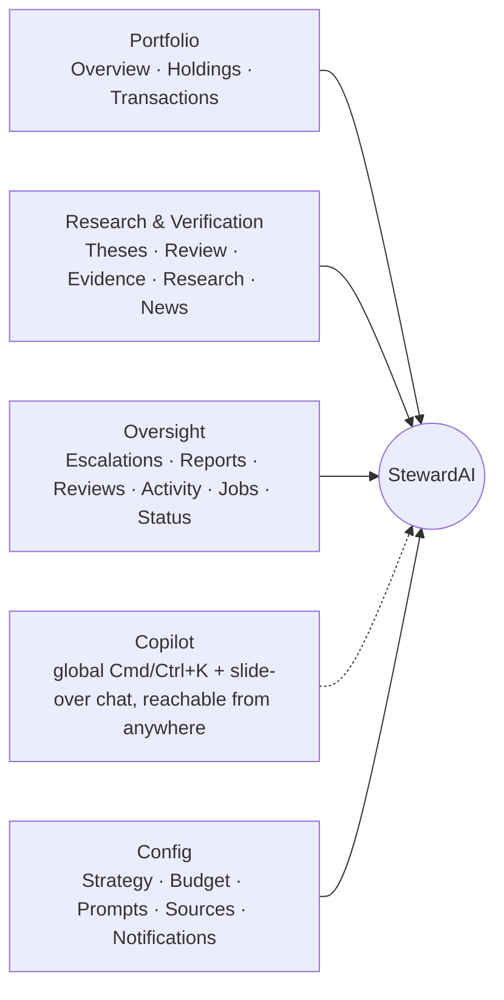

# Ledger — a calm, evidence-led design system for StewardAI

**Status:** Research, proposal, and plan only — no implementation yet.
**Companion artifact (live, with rendered swatches and charts):** https://claude.ai/artifact/H8bw7QbVZbbLYRn8X2idJp

StewardAI isn't a budgeting app or a trading app — it's a research assistant that watches one real brokerage account, holds itself to a standard of proof, and tells its owner what changed and why. This proposal treats that as the whole brief: verification is not a feature, it's the interface.

---

## Table of contents

1. [Research](#1-research)
2. [Design principles](#2-design-principles)
3. [Information architecture](#3-information-architecture)
4. [Design system: Ledger](#4-design-system-ledger)
5. [Visualization language](#5-visualization-language)
6. [Component patterns](#6-component-patterns)
7. [Roadmap](#7-roadmap)
8. [Success criteria](#8-success-criteria)
9. [Sources](#9-sources)

---

## 1. Research

### What the current codebase already is

Direct read of the repo, not assumption:

- **Frontend:** Next.js 16 (App Router, TypeScript, Turbopack), React 19, Tailwind CSS v4 with a stripped default palette — only custom token utility classes exist, enforced by `scripts/check-colors.mjs`.
- **Components:** shadcn/ui (Radix primitives) plus a planned but mostly-unbuilt "Tremor Raw" set.
- **Charts:** Recharts, used in exactly one real chart (`price-chart.tsx` — a rebased line chart vs. benchmark) and one hand-rolled bar-list (`allocation-bars.tsx`).
- **Tokens:** `src/app/tokens.css` already uses OKLCH, with parallel light/dark values, a single accent, gain/loss reserved strictly for financial state, and a separate neutral/warning/info/disputed palette for confidence and severity. This is the right architecture — Ledger keeps it and replaces the values.
- **Routes:** Overview, Holdings (+ ticker detail), Theses, Review, Transactions, Config (a dozen sub-routes), Activity, Escalations (+ detail), Evidence, Jobs, News (+ disputed), Reports, Research, Reviews (monthly compliance), Status, Chat (global slide-over), plus a Cmd/Ctrl+K command palette reaching nearly everything.

### The competitive landscape

| | Copilot Money / Monarch Money | Robinhood | Wealthfront | Cleo | **StewardAI** |
|---|---|---|---|---|---|
| Primary job | Track spending & net worth | Trade | Robo-advice / planning | Answer "can I afford it?" | **Verify a thesis is still true** |
| Update cadence | Daily | Real-time, tick-by-tick | Periodic | On demand | **Event-driven — a filing, a price move, a news item** |
| Core unit | Transaction | Order | Portfolio allocation | Message | **Claim + evidence** |
| Trust mechanism | Bank-grade badges | Regulatory disclosures | Institutional-grade planning tools | Personality / tone | **Citations, source scoring, confidence states** |
| UI density | Low, card-based | Low, chart-first | Medium | Very low, chat-first | **Deliberately higher — this is a research tool** |

**What's worth borrowing:** color-coded category cards, AI-reordered dashboards, sparkline-first holdings cards, a single net-worth-style hero figure, chat that answers questions in plain language, dark mode designed as a first-class palette rather than an inverted filter.

**What's worth ignoring:** the category's low information density. StewardAI's owner is reviewing evidence, not glancing at a balance — the redesign should read more like a research terminal wearing a consumer app's manners than a consumer app wearing a terminal's clothes.

### What 2026 fintech UI has converged on

- Color-coded, AI-reordered cards; horizontal hubs instead of cluttered home screens.
- Glanceable mobile flows — a 3-click desktop task should be 1 tap on mobile.
- Onboarding that proves value before asking for account access.
- Dark mode designed as its own palette from the start, not a CSS filter.

### What finance-specific accessibility research says

Red/green gain-loss coding is unreadable to the ~8% of men with red-green color vision deficiency (deuteranopia/protanopia). The fix isn't removing color — it's shifting the pair toward **blue-green vs. orange-red** (higher inherent contrast under every CVD simulation) and never relying on hue alone: a sign (`+`/`−`), an arrow, and a label always ride along with the color.

---

## 2. Design principles

Six rules specific enough to StewardAI that they'd be wrong for a different app:

1. **Confidence is a first-class visual, not a footnote.** Verified / Corroborated / Unconfirmed / Disputed gets the same visual weight as gain and loss — a fixed color, a fixed icon, the same chip everywhere it appears.
2. **Every number that could be wrong links to why it might be right.** A price, a KPI, a claim in a report — if it's backed by evidence, the evidence is one tap away, not buried in a separate review queue. Citations are a UI primitive, not a modal.
3. **Density earns its keep.** This is a tool for reviewing a portfolio thesis, not a five-second glance app. Dense tables and small multiples are fine when the content is genuinely comparative — but every dense screen still opens with one clear hero number or verdict.
4. **Cool means expected, warm means look here.** One consistent temperature language runs through the whole app: teal/blue for on-plan, verified, and gaining; amber/red for drift, disputed, and losing. Once, and consistently, so the eye learns it in a week.
5. **The AI shows its work.** Chat answers, digests, and reports read like a colleague citing sources, never like an oracle. Every generated claim carries a confidence chip and a citation, in the same visual language as the rest of the app.
6. **Numbers align, always.** Tabular figures in tables, tickers, and axis ticks; proportional figures only for hero numbers and stat tiles. A portfolio table where digits don't line up reads as untrustworthy before anyone's read a single row.

---

## 3. Information architecture

The current app organizes 20+ routes by **feature**. The proposal reorganizes by **job**, with Chat staying a global slide-over rather than a destination.

| Cluster | Job | Routes |
|---|---|---|
| **Portfolio** | "What do I hold and how has it done." | Overview (KPI row + performance chart), Holdings, Transactions |
| **Research & Verification** | "Is my thesis still true." | Theses, Review, Evidence, Research, News |
| **Oversight** | "What needs my attention and what happened." | Escalations, Reports, Reviews (compliance), Activity, Jobs/Status |
| **Copilot** | Ambient, not a destination | Global Cmd/Ctrl+K + chat slide-over |
| **Config** | Settings | Strategy, Budget, Prompts, Sources, Notifications, etc. |

---

## 4. Design system: Ledger

### 4.1 Brand & surface colors

| Token | Light | Dark | Role |
|---|---|---|---|
| Accent ("Verdigris") | `#157a5b` | `#35b98c` | Buttons, links, focus rings, active nav — the one color the eye should always find |
| Page | `#f6f7f4` | `#0c110e` | App canvas — a whisper of green in the gray, never true cream |
| Surface | `#ffffff` | `#131a16` | Cards & panels — border does the separating, not shadow |
| Surface (muted) | `#eef1ec` | `#182019` | Table headers, secondary panels |
| Ink (primary text) | `#0b1210` | `#f2f4f1` | 17.8:1 contrast on Page. Never pure black — carries a hint of the accent's hue |
| Ink (secondary) | `#52564f` | `#b9c0b7` | 7.0–10.2:1 contrast |
| Border | `rgba(11,20,17,.11)` | `rgba(255,255,255,.09)` | Hairline separators |

**Why not the obvious fintech palette:** the category defaults to blue-on-white (trust, cliché) or near-black-with-neon (2026's other cliché). Verdigris — an aged-bronze-plaque green — reads as *stewardship and permanence* rather than *growth-hack startup*, and is rare enough in the category to be memorable on its own.

**Accent ramp** (also the sequential hue for confidence scores, verification progress, and risk heatmaps): `#0d4a37 → #157a5b → #1b9670 → #3fae86 → #8fd2bb → #cdece2`

### 4.2 The four semantic states — validated, not eyeballed

Every pair below was run through the data-viz skill's OKLab colorblindness validator (Machado–Oliveira–Fernandes simulation) via `node validate_palette.js`, iterated until it passed, rather than judged by eye.

| Role | Light | Dark | Meaning |
|---|---|---|---|
| Gain | `#0f8f6a` | `#26a97f` | Always paired with `+` and an up-arrow — color is never the only signal |
| Loss | `#c0472b` | `#d9663e` | Vermillion, not pure red — deuteranopia-safe against Gain |
| Verified | `#2a66d6` | `#5b90e8` | Independently confirmed by a trusted primary source |
| Corroborated | `#1b9670` | `#1f9e8a` | Backed by a secondary source, not yet independently confirmed |
| Unconfirmed | `#c98500` | `#b87d18` | A claim awaiting review — caution, not alarm |
| Disputed | `#b0303f` | `#e0546a` | Sources actively disagree — the one state that should feel urgent |

**Validation report:**

| Pair | Mode | Lightness band | CVD ΔE (worst adjacent) | Normal-vision ΔE | Contrast vs. surface |
|---|---|---|---|---|---|
| Gain ↔ Loss | Light | PASS | 8.2 | 25.5 | ≥3:1 |
| Gain ↔ Loss | Dark | PASS | 8.6 | 25.8 | ≥3:1 |
| Verified·Corroborated·Unconfirmed·Disputed | Light | PASS | 8.9 | 20.2 | WARN — Unconfirmed 2.98:1 |
| Verified·Corroborated·Unconfirmed·Disputed | Dark | PASS | 6.9 (floor band) | 15.6 | ≥3:1 |

Both WARNs are inside legal bounds *because* status colors are already required to ship with an icon and a label (Principle 1) — the mandatory secondary encoding the validator asks for is a rule this system already follows, not an exception granted to it.

Independently computed WCAG text contrast (Ink/Page/Surface, and Accent as UI text):

| Pair | Ratio |
|---|---|
| Accent on white (light) | 5.29:1 |
| Accent on dark surface (dark) | 9.99:1 |
| Text-primary on page (light) | 17.79:1 |
| Text-secondary on page (light) | 7.03:1 |
| Text-primary on page (dark) | 17.09:1 |
| Text-secondary on page (dark) | 10.16:1 |

### 4.3 Categorical palette (identity — sectors, sources, account types)

Reused wholesale from the data-viz skill's own accessibility-validated 8-hue set, in fixed order, never cycled. Kept separate from the four semantic hues above: categorical color answers "which one," semantic color answers "what state" — they're never mixed within a single chart, so their hues can coexist across the app without colliding in view.

| Slot | Hue | Light | Dark |
|---|---|---|---|
| 1 | blue | `#2a78d6` | `#3987e5` |
| 2 | orange | `#eb6834` | `#d95926` |
| 3 | aqua | `#1baf7a` | `#199e70` |
| 4 | yellow | `#eda100` | `#c98500` |
| 5 | magenta | `#e87ba4` | `#d55181` |
| 6 | green | `#008300` | `#008300` |
| 7 | violet | `#4a3aa7` | `#9085e9` |
| 8 | red | `#e34948` | `#e66767` |

Example fixed mapping for portfolio allocation charts: Equities → slot 1 (blue), Fixed Income → slot 7 (violet), Cash → slot 3 (aqua), Crypto → slot 5 (magenta), Alternatives → slot 4 (yellow). Series-count ladder: 1–3 series, color alone is comfortable; 4, direct labels become mandatory; 7–8 is the token ceiling — beyond it, fold into "Other" or facet into small multiples.

### 4.4 Diverging pair (drift / delta-to-target)

Cool = underweight ("as expected"), warm = overweight ("look here"), neutral gray at zero:

- Under target: `#2a78d6` (light) / `#3987e5` (dark)
- Over target: `#c98500` (light) / `#b87d18` (dark)
- Neutral midpoint: `#eceee9` (light) / `#232922` (dark)

### 4.5 Typography

Three faces from one family — IBM Plex — chosen deliberately over the category's Inter/Space Grotesk default:

| Face | Usage |
|---|---|
| **IBM Plex Serif** | Report headings, thesis statements, digest summaries — anywhere the app is making an argument, not just showing a number. Reads like a prospectus, not a landing page. |
| **IBM Plex Sans** | All UI: nav, buttons, body copy, table headers. |
| **IBM Plex Mono** | Tickers, prices, timestamps, percentages, code, and every column of numbers that must line up. |

Rule: **proportional figures** for large standalone numbers (hero figures, stat-tile values); **tabular figures** (`font-variant-numeric: tabular-nums`) reserved for columns that must align vertically (tables, axis ticks).

### 4.6 Space, radius, elevation, motion

| Token | Spec |
|---|---|
| Grid | 4px base unit; component padding on 8/12/16px; section rhythm on 24/32/48px |
| Radius | 4px controls, 8px cards, 14px sheets/modals — tighter than the category default; precision over friendliness |
| Elevation | Hairline borders do the separating everywhere; shadow reserved for genuinely floating layers (command palette, toasts, chat panel) |
| Motion | 120–180ms ease for hover/press, 200–260ms for panel transitions; no springs; `prefers-reduced-motion` disables all of it |

---

## 5. Visualization language

Every chart follows a fixed mark spec: 2px lines with round caps, ≤24px bars with a 4px rounded data-end (square at the baseline), an 8px+ end-marker with a 2px surface-color ring, a 2px surface gap between touching segments, and hairline (1px, solid, never dashed) gridlines. Library stack: **keep Recharts** (already the dependency, sufficient for portfolio-history point counts), **adopt Tremor Raw** (referenced in the repo but unbuilt — copy-paste primitives for stat tiles and bar-lists), **reach for visx only if** a fully bespoke visualization is needed (e.g. a correlation-matrix heatmap). Skip Nivo/ECharts — the app's data volumes don't justify the bundle cost.

| # | Chart | Form | Where | Why this form |
|---|---|---|---|---|
| A | Portfolio value vs. benchmark, 12 months indexed to 100 | **Emphasis line** — accent hue + 10%-opacity area wash for the portfolio, dashed de-emphasis gray for the benchmark, direct end-labels | Overview | One series is the story, the other is context — already the correct pattern in `price-chart.tsx`, extended app-wide |
| B | Allocation by asset class | **Stacked bar** (single row, categorical hues, 2px surface gaps) | Portfolio | Deliberately *not* a donut: a bar makes shares comparable by length instead of estimated angle, and needs no legend-eating center hole |
| C | Drift from target allocation | **Diverging bar** around a zero baseline (warm = overweight, cool = underweight) | Portfolio | This is a delta-to-target question, which diverging bars answer directly |
| D | Fact confidence by thesis | **Ordinal 100% stacked bar**, fixed left-to-right order (Verified → Corroborated → Unconfirmed → Disputed) | Theses & Review | The confidence scale is ordinal, not categorical — trustworthiness reads as a shape (how far the bar gets before it turns amber) before anyone reads a number |
| E | Thesis KPI row | **Stat tiles** (label, value, signed delta, 12-point sparkline in de-emphasis gray, current-period color only when the delta is the story) | Overview | The data's job is "a handful of headline numbers," which is a KPI row, not a chart |
| F | Escalation & event timeline | **Severity timeline** — dots colored by severity (info/caution/critical) plus label, never a differently-shaped marker per severity | Oversight | Shape is reserved for filtering, not decoration; severity is a dot color + label pairing exactly like every other status in the system |

### Illustrative sample data (for the mockups above; not real portfolio data)

**Allocation by asset class:** Equities 54% · Fixed Income 18% · Cash 12% · Alternatives 7% · Crypto 9%

**Drift from target:** Equities +4.2pp · Fixed Income −3.1pp · Cash +1.8pp · Crypto +2.5pp · Alternatives −5.4pp

**Performance, 12 months indexed to 100:** Portfolio ends at +27%, benchmark ends at +16%

---

## 6. Component patterns

- **Confidence & severity chips.** One pill shape, four colors, always icon + label. Used identically in the fact Review queue, on Thesis cards, and inline in Chat citations.
- **Command palette (Cmd/Ctrl+K).** Reaches every route in the five-cluster IA without a nested menu — the primary way a power user navigates a 20-route app.
- **Chat with inline citations.** AI answers wear the same confidence chip as everything else (e.g. a "Verified" chip plus source pills like `10-Q · Q1 FY26`) — no separate "AI-generated" styling that implies a lower standard of proof.
- **Holding rows.** Ticker + name, then shares/value/today's-change in tabular figures, right-aligned, gain/loss colored with a signed prefix.

---

## 7. Roadmap

Scoped as **Phases 6–10**, continuing the codebase's existing Phase 0–5 numbering, so it reads as a continuation, not a rewrite.

| Phase | Name | Scope | Touches |
|---|---|---|---|
| **6** | Token foundation | Replace OKLCH values in `tokens.css` with the validated Ledger set; wire IBM Plex Sans/Serif/Mono; update `check-colors.mjs` to lint the new token names. No screen changes — invisible, low-risk. | `tokens.css`, `check-colors.mjs` |
| **7** | Overview & Portfolio visualization | Rebuild Overview around the KPI row + performance-vs-benchmark chart; replace hand-rolled `allocation-bars.tsx` with the validated stacked-bar and diverging-drift components; ship Tremor Raw stat tiles. | Overview, Holdings, Recharts, Tremor Raw |
| **8** | Confidence & evidence UI | Ship the four-state confidence chip system across Theses, Review, and Evidence; add the ordinal fact-confidence bar; standardize the citation component for Chat and Reports. | Theses, Review, Evidence, Chat |
| **9** | Oversight & navigation restructure | Group Escalations, Reports, Reviews, Activity, and Jobs/Status behind the new Oversight cluster with the severity-timeline pattern; rebuild the command palette against the five-cluster IA. | IA regroup, Cmd/Ctrl+K |
| **10** | Motion, accessibility audit, polish | Apply the motion spec across panel transitions; run an automated + manual WCAG AA pass on both themes; ship a colorblind-alternate toggle for gain/loss; dark-mode QA on every screen touched in Phases 7–9. | a11y audit, dark mode, motion |

---

## 8. Success criteria

**Measurable:** every gain/loss and confidence pair passes the CVD validator in both themes (already true for the four pairs specified above). Body text holds ≥4.5:1, UI elements ≥3:1, in light and dark. Time-to-find for "why did this holding change" drops — the evidence is one tap from the number, not a queue away.

**Qualitative:** a screenshot of Overview should read as "a serious research tool" before anyone reads a single figure. Chat answers should feel citation-backed by default, never like an oracle. No screen should need red/green alone to make its point.

---

## 9. Sources

- [Eleken — Fintech design guide with patterns that build trust (2026)](https://www.eleken.co/blog-posts/modern-fintech-design-guide)
- [Eleken — Fintech UI examples to build trust, 15 real apps](https://www.eleken.co/blog-posts/trusted-fintech-ui-examples)
- [Monavio — Monarch Money vs Copilot Money (2026)](https://monavio.app/blog/monarch-money-vs-copilot-money/)
- [ColorArchive — Color in Financial UI: Trust, Data Visualization, and the Red/Green Convention](https://colorarchive.org/guides/financial-ui-color-guide/)
- [Tableau — Designing colorblind-friendly visualizations](https://www.tableau.com/blog/examining-data-viz-rules-dont-use-red-green-together)
- [Sigma — A guide to creating data charts for color blindness](https://www.sigmacomputing.com/blog/data-charts-color-blindness)
- [Finny — The best budget app if you're colorblind (2026)](https://getfinny.app/blog/colorblind-budget-app)
- [PkgPulse — Recharts v3 vs Tremor vs Nivo, React charting 2026](https://www.pkgpulse.com/guides/recharts-v3-vs-tremor-vs-nivo-react-charting-2026)
- [Querio — 8 top React chart libraries for data visualization (2026)](https://querio.ai/articles/top-react-chart-libraries-data-visualization)
- [Lollypop — Investment dashboard UX design: portfolio UI principles for higher retention](https://lollypop.design/blog/2026/may/investment-dashboard-ux-design-guide/)
- [Procreator — 10 best fintech UX practices for mobile apps (2026)](https://procreator.design/blog/best-fintech-ux-practices-for-mobile-apps/)
- [G&CO — The best UX design practices for finance apps (2026)](https://www.g-co.agency/insights/the-best-ux-design-practices-for-finance-apps)
- [Medium / Bootcamp — Building a design system for a fintech loan platform](https://medium.com/design-bootcamp/how-i-built-a-design-system-for-a-fintech-loan-platform-2c7de4a829eb)
- [DesignSystems.one — Stripe Design System](https://www.designsystems.one/design-systems/stripe-design)

Plus a direct read of the StewardAI repository — `tokens.css`, `price-chart.tsx`, `allocation-bars.tsx`, and the full app route tree — to ground every recommendation above in what already exists rather than a generic template.
