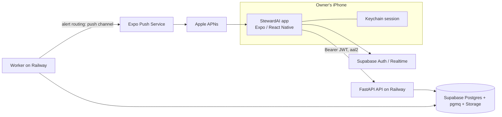

# StewardAI iOS mobile app implementation plan

Replaces the former Windows desktop plan. The backend (FastAPI API plus worker, run by `apps/backend/start.sh`) is deployed on Railway, the Next.js web app on Vercel, and Supabase is the database, Auth, Realtime and evidence-storage service. The iOS app is a **native React Native (Expo) app** that matches the web app's look, adjusted for a phone. The developer machine is Windows with no Mac, so Swift is ruled out in practice (see decision 1).

## Goal and constraints

Deliver an iOS app for the single owner that:

- Looks like the web app: the same colour tokens, typography, hairline-framed "Industry" style, light/dark modes, and the same components and charts, laid out for a phone rather than redesigned.
- Signs in with the existing Supabase account and TOTP MFA, and calls the deployed API with the same bearer JWT the web app sends. No backend auth change.
- Delivers alerts as native push notifications, as a third channel beside Telegram and email.
- Is developed and built entirely from Windows: iterate on a physical iPhone with an EAS development build, ship through TestFlight.
- Holds no backend secrets. The binary contains only the public Supabase URL and key and the public API URL.

## Scale of the port (from the current web code)

- 49 routes under `apps/web/src/app`, about 141 component/lib `.tsx` files, 4 chart files that use recharts (`contribution-waterfall`, `price-chart`, `spark-chart`, plus the tremor wrapper), and one design-token file (`tokens.css`) that is the only place colours are allowed.
- Data access is already separated: `src/lib/*` holds typed API clients (`openapi-fetch` with generated types) and Supabase helpers. Much of this is reusable as is.
- Because the screens are many, the first release is staged by screen priority (Phase 2 and 3), not 1:1 parity on day one.

## Proposed architecture

The app is a thin native client. All heavy work stays in the deployed worker.

## Decisions and recommendations

1. **Swift or React Native: React Native with Expo.** Swift/SwiftUI needs Xcode, which only runs on macOS. Without a Mac you would depend on cloud Macs (rented or CI) for every compile, run and debug cycle, and could not use the simulator or live reload from Windows. That makes UI work slow and error-prone. Expo's EAS Build compiles iOS in the cloud, and a development build on your own iPhone gives live reload from Windows. SwiftUI would also add a second language and duplicate API models. Choose React Native (Expo, TypeScript).
2. **Matching the web look: share the design tokens and use NativeWind.** NativeWind brings Tailwind's utility-class model to React Native, so web class names (`bg-surface text-text border-border text-gain`) carry over with small edits. Move the token values out of `tokens.css` into a shared TypeScript tokens module that generates both the web CSS variables and the NativeWind theme, so there is one source of truth. Keep the rule that colour literals live only in the tokens file, with a lint check like `lint:colors`.
3. **Fonts.** The web app uses Barlow, Barlow Condensed, IBM Plex Mono and IBM Plex Serif from `@fontsource`. Load the same families in the app with `expo-font` using the `@expo-google-fonts` packages, so type matches.
4. **Charts: chosen for fidelity, `react-native-svg` for static charts and Victory Native XL (Skia) for the interactive price chart.** Recharts does not run in React Native, but only four files use it. Hand-built SVG gives exact control over the sparklines and the contribution waterfall, so they match the web's hairline style; Victory Native handles touch scrubbing on the price chart. Rebuild with the same data and token colours, and compare each chart side by side with the web before sign-off. Do not attempt a recharts wrapper.
5. **Routing and project layout: Expo Router in a new `apps/mobile`**, with a shared `packages/` workspace for tokens, API client and pure logic (`format.ts`, `freshness.ts`, `palette.ts`, `parse-untyped.ts`, their tests). Moving these into a package lets web and mobile import the same tested code; it needs a small npm-workspaces setup at the repo root. If that refactor is too disruptive, copy-with-tests is the fallback, at the cost of drift.
6. **Auth: native Supabase session with Keychain storage.** Use `@supabase/supabase-js` with an `expo-secure-store` adapter, the Supabase MFA API for TOTP, and the same `aal2` requirement the API enforces (`api/auth.py`). Port `decideAccess` from `src/lib/auth/access.ts` so route guarding logic matches the web.
7. **App lock: Face ID/passcode via `expo-local-authentication`** on cold start and after a short background timeout, with the app-switcher snapshot covered. It protects the stored session and does not replace MFA.
8. **Push: Expo push tokens through the Expo Push Service** to APNs. With a native Expo app this is the simplest route, avoiding APNs HTTP/2 and key handling in the worker. Revisit direct APNs only if Expo's service becomes a limit.
9. **Builds without a Mac: EAS Build** for development, preview and production profiles, plus EAS Submit to TestFlight. Apple credentials (distribution certificate, provisioning, APNs key) are created and stored by EAS. Alternative: GitHub Actions macOS runners, which is more work and not needed.
10. **Distribution: TestFlight internal testing, one owner.** Requires the Apple Developer Program (annual fee). Public App Store release is out of scope.
11. **Updates: TestFlight builds only.** No EAS Update and no over-the-air code changes; every change is a new tagged build. Slower for small fixes, but simpler and every installed version is a known, signed build.
12. **Scope and versions: build everything, staged.** **Version 0 is alerts only**: sign-in with MFA, Face ID lock, the alert list and detail, and push notifications. **Version 1 onward adds everything else** in priority order until the app covers the whole web app, including the dense editors (strategy, jobs, notification rules, data sources), redesigned for a phone where needed. Each version ships to TestFlight when it is useful, not at the end.
13. **Phone layout.** Bottom tab bar for the main sections with a "More" screen for the rest, compact page headers, tables turned into card lists or horizontally scrollable regions, charts sized to width, bottom sheets for dialogs. These adapt the web layout and do not change visual language.
14. **Offline.** Show a cached last-known overview (and, in version 0, the last-fetched alert list) with clear stale labels; other screens show an offline state. No local database.
15. **Push content.** Generic title, short text and an alert id only, never values. There is no opt-in to show values. Tapping deep-links to the alert or holding.
16. **API contract.** Generate `schema.d.ts` from `openapi.json` for both clients, fail CI if it is stale, and add a minimum-app-version check so a breaking API change can force an update.
17. **Resolved inputs.** Apple Developer account: owner has one. Production API: `https://api.stewardai.cz` (the app's only API base URL; keep it in EAS build profiles, not in source). Minimum iOS: 27, set as the deployment target, so the app can use current platform APIs and drop legacy workarounds. Before Phase 0, confirm that the pinned Expo SDK and the EAS iOS build image support the iOS 27 SDK; if they lag, build against the newest supported SDK and keep the iOS 27 minimum.
18. **Sequencing against other work.** This plan is implemented after the other plans in `docs/plans/`. The exception is the backend half of version 0 (device table, registration routes and the `push` alert channel), which is implemented now because it extends the existing alert pipeline and is independent of the mobile app. See Phase 2.

## Versions

- **Version 0 (alerts):** MFA sign-in, Face ID lock, alert list and detail with deep links, push notifications, minimal settings (push on/off). Includes the backend push work.
- **Version 1 (read core):** overview, holdings and holding detail with charts, news, research and theses, status.
- **Version 2 (actions and assistant):** chat, acknowledge/dismiss alerts, escalation approvals, notification rules and quiet hours.
- **Version 3 (full parity):** every remaining screen and editor, including strategy, jobs and data-source management, adapted for a phone.

Each version ends with a TestFlight build and its own short sign-off.

## Implementation phases

### Phase 0: Validate the path

- Create the bundle identifier, App Store Connect record, EAS project and App Store Connect API key (Apple Developer account already exists).
- Confirm the pinned Expo SDK and EAS build image support the iOS 27 SDK and an iOS 27 deployment target.
- Spike on a physical iPhone from Windows: an EAS development build that signs in against the real Supabase project, completes TOTP MFA, calls an authenticated route on `https://api.stewardai.cz`, and renders one NativeWind component styled from the shared tokens with the web fonts in light and dark mode.
- Confirm the API works from the phone on cellular. Native requests ignore CORS, so `cors_origins` needs no change. Check the Supabase redirect allowlist for the app URL scheme (only needed for email links).
- Write the screen inventory: each of the 49 routes, its API routes, response sizes and whether it needs pagination or a slimmer shape, assigned to version 1, 2 or 3.
- Decide the workspace layout and which web `lib` modules move into a shared package.

**Exit criteria:** a development build runs on the iPhone with MFA sign-in, data from the API and token-accurate styling; the inventory is written.

### Phase 1: Foundation and design system

- Create `apps/mobile` (Expo, strict TypeScript, Expo Router) with lint, typecheck and test scripts matching `apps/web`.
- Extract tokens into the shared module; generate web CSS variables from it and the NativeWind theme, with light and dark values and a colour-literal lint.
- Port the base UI kit from `components/ui` and shared pieces: `Button`, `Card`, `Input`, `Label`, `StatusDot`, `Blueprint`, `EmptyState`, `PageHeader`, freshness badges, `AlertMessage`, TOTP code field. Match spacing, hairline borders and type scale and verify side by side with the web on the same data.
- API client wrapper with token attach, a single refresh-and-retry on 401, then sign-out.
- Auth screens (login, MFA enrol/verify), session restore, lock screen, route guard.
- Shell: safe areas, offline banner, theme following system with manual override, pull-to-refresh pattern.
- Reuse shared pure logic from the web `lib` folder with its tests.

**Exit criteria:** a themed, authenticated shell with session persistence and lock, the base UI kit matching the web, a typed API client and green CI for the mobile package.

### Phase 2: Version 0, alerts and push

Backend (implement now, independent of the app):

- Migration for a `device` table (user id, Expo push token, platform, app version, last seen, active flag) with RLS and `app_backend` grants.
- Owner-only, `aal2` routes to register, refresh and delete a token; regenerate `openapi.json` and the web types.
- A `push` channel in `steward/notify/channels.py`; extend `Channel` in `steward/config/notifications.py` and the routing in `steward/notify/route.py`. Keep quiet hours, digest and the stored `alert` row behavior. Batch sends to the Expo push service, read receipts, deactivate tokens on `DeviceNotRegistered`, retry transient errors, and never block the alert pipeline on a push failure. Payloads are generic text plus an alert id only.
- Tests for routing, quiet hours, token deactivation and payload contents.

App:

- Alert list (severity and ticker filters) and alert detail, matching the web alert trail, with links opened in the in-app browser.
- Permission prompt at a sensible moment, token registration after sign-in, refresh, and deletion on sign-out.
- Notification tap deep-links to the alert; foreground banner.
- Settings: push on/off and sign-out. Rule editing stays on the web until version 2.
- Cached last-fetched alert list for offline.

**Exit criteria:** a real alert from the deployed worker arrives as a push on the phone, respects quiet hours, deep-links to the right alert, and a revoked token is deactivated automatically. The first TestFlight build ships.

### Phase 3: Version 1, read core

Build in order, each against the existing API:

1. **Overview:** value, day change, allocation, freshness, market strip as a compact row.
2. **Holdings and holding detail:** positions, weights, price chart, valuation summary, linked news and thesis.
3. **News** (beyond alerts): feed, article detail, ticker filters.
4. **Research and theses:** list and reader, evidence links via signed URLs.
5. **Status:** worker heartbeat, last successful jobs, budget and source health.

Rebuild the recharts charts here (price chart, sparkline, contribution waterfall) and compare each with the web. Every screen has paged lists, skeletons and honest stale-data labelling, with no business logic duplicated from the backend.

**Exit criteria:** these screens work on production data on a physical device in light and dark mode and look like the web equivalents.

### Phase 4: Version 2, actions and assistant

- Assistant chat with streaming per the existing chat routes, under the same budget guard.
- Acknowledge or dismiss alerts; approve or reject escalations.
- Notification rules and quiet hours editor for all channels, laid out for a phone.
- Minimum-supported-version check exposed by the API and enforced in the app.

**Exit criteria:** chat, alert actions, escalation approvals and rule editing work end to end on the phone.

### Phase 5: Version 3, full parity and security review

- Port remaining screens in inventory order: funds, macro, screens, reports, verification, reference, graph, transactions, config editors (strategy, jobs, data sources). Use phone-appropriate patterns (steppers, bottom sheets, section lists) while keeping the web's visual language; JSON-style editors get a structured form or a read-only view plus an "Open on web" link where a phone editor would be unsafe.
- Security review: Keychain-only session, nothing sensitive in AsyncStorage or logs, app-switcher cover, TLS defaults, owner and `aal2` rejection confirmed from the app, push payload and token handling, dependency and licence audit, and only public values in the binary and build secrets.

**Exit criteria:** every web screen has a phone equivalent or a documented reason for none; the written security checklist is complete with no open findings.

### Phase 6: CI, release and polish

- GitHub Actions on changes to `apps/mobile`, shared packages or `openapi.json`: lint, typecheck, tests, token-literal check and generated-types freshness. The existing `ci.yml` jobs stay unchanged. Add this early, alongside Phase 1, and extend it as versions land.
- EAS profiles: development (dev client), preview (internal), production (TestFlight). Pin Expo SDK, Node and package versions. Production builds and `eas submit` run only from a tag or manual approval. There is no OTA update service; rollback means re-promoting the previous TestFlight build.
- Accessibility: Dynamic Type, VoiceOver labels, contrast in both themes, reduced motion.
- Performance on the oldest iPhone that runs iOS 27: cold start, long lists, chart screens, memory during chat streaming.
- Live-data sign-off on the phone: sign-in, MFA, token refresh, every screen, alert to push to deep link, chat, offline behavior and a 24-hour soak.
- Optional, deferred: a widget and Live Activities, which need native Swift extensions through Expo config plugins and belong in separate work.

**Exit criteria:** a tagged release reaches TestFlight, rollback has been rehearsed once, and the owner uses the build for a week with no blocking issues.

## Security and operational requirements

- `SUPABASE_SECRET_KEY`, `DATABASE_URL`, Trading212 and Anthropic keys stay on Railway and never enter the app. The Expo push access token, if used, stays a Railway secret too.
- Keep Supabase RLS, the owner guard, MFA (`aal2`), JWT verification and the least-privilege `app_backend` role. The app is just another authenticated caller.
- All traffic over TLS; no inbound ports on the phone.
- Redact logs and crash reports; no financial values or tokens in them. Push payloads never contain values.
- Single owner, iPhone only, iOS 27 and later. Multi-user, public App Store and Android are separate work.

## Cost and scope

- Apple Developer Program is an annual fee. EAS Build has a free tier with monthly build limits; check current terms, since every change is a TestFlight build. Expo push is free at this volume.
- Railway, Vercel and Supabase costs are unchanged apart from small extra API traffic. Claude and provider spend stay under the existing budget guard.
- The main cost is engineering time: about 49 routes of UI across versions 1 to 3.

## Recommended delivery order

1. Now: the Phase 2 backend work (device table, routes, `push` channel, tests), because it extends the existing alert pipeline and does not depend on the app.
2. After the other plans: Phase 0 spike, Phase 1 foundation with early CI.
3. Version 0 app (Phase 2 app half) and the first TestFlight build.
4. Version 1, then version 2, then version 3.
5. Security review, accessibility, performance and the live-data sign-off.

Do not start by porting all 49 routes. The deployed API and worker serve the web app unchanged, except for the push-device additions in Phase 2.
