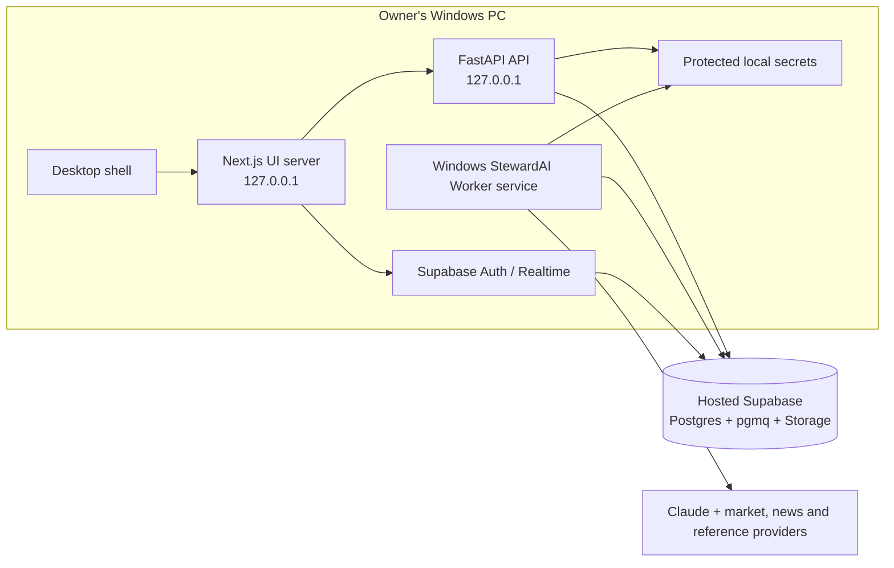

# StewardAI Windows desktop implementation plan

Research snapshot: 29 September 2026. This plan keeps the existing Supabase project as the database, Auth, Realtime and evidence-storage service. The UI, FastAPI backend and job worker run on the owner's Windows PC.

## Goal and constraints

Deliver an installable Windows desktop app that:

- Opens the existing StewardAI interface in an app window, with no browser setup required.
- Runs the Next.js UI server and FastAPI API locally, with the desktop app managing their lifecycle.
- Runs the existing Python worker persistently and separately as a Windows service by default, with a scheduled-task option for a per-user install.
- Connects to the existing hosted Supabase project; it does not install, migrate, or copy the database locally.
- Keeps the existing Supabase sign-in, TOTP MFA, owner checks, RLS and API authorization model.
- Keeps secrets on the owner's machine and never places backend credentials in the frontend bundle or installer.

This is a packaging and local-process integration project, not a conversion of the frontend to a new UI framework. The existing API and worker already run as separate processes, the worker includes a Windows signal-handler fallback, and the repository includes local-development commands for all three apps. The project is not yet a packaged desktop application.

## Proposed architecture

The desktop shell starts the UI server and API, waits for their health checks, then opens the local UI. The worker is not owned by the window: Windows starts and restarts it independently, including after the user closes the app. Both backend processes connect to the same hosted database and queue. The UI continues to sign in directly with Supabase and sends its MFA-verified JWT to the local API, matching the current design.

## Decisions to lock before implementation

1. **Desktop runtime: Tauri + Windows WebView2, subject to a short compatibility prototype.** Keeping RAM and install footprint low is a product requirement. Tauri uses the system WebView2 runtime instead of bundling another Chromium runtime as Electron does. The current Next.js server still needs Node as a local sidecar, so Tauri does not remove that process; measure the whole stack before committing. If Next.js auth/SSR behavior cannot run reliably in Tauri, compare Electron against the measured memory budget before choosing it.
2. **Worker installation: Windows service by default.** Use a maintained service wrapper such as WinSW around the packaged worker executable. Offer a per-user Task Scheduler mode if the user does not want to grant installer elevation. Both modes must start at boot or user logon as selected, restart on failure, and log to the same managed application-data directory.
3. **API and UI lifecycle: app-managed local child processes.** Bind only to loopback, reserve or dynamically discover ports, verify readiness, and stop the child processes cleanly when the desktop app exits. They do not need to run while the UI is closed.
4. **Cloud connection compatibility.** Prefer the Supabase session pooler when the Windows network has no IPv6 route to the project's direct database host. The existing setup documentation already flags the direct host's IPv6-only behavior.
5. **Distribution is initially for one owner and one PC.** Do not ship a shared installer containing a database password, Supabase secret key, Trading212 key, or Anthropic key. The owner supplies their own values during first-run setup.

## Implementation phases

### Phase 0 — Validate the desktop path and contracts

- Record the actual frontend port and runtime requirements. `apps/web/package.json` currently uses port 4000 for `dev`, while `.env.example`, Supabase redirect configuration and several docs refer to port 3000; choose one packaged origin and reconcile all references.
- Confirm production Next.js output mode and runtime environment behavior. `NEXT_PUBLIC_*` values are build-time values in the current setup, so the local API URL and Supabase public URL/key need a deliberate build/runtime configuration approach.
- Confirm local API routes accept only the packaged UI origin and bind to `127.0.0.1`; do not expose the local API to the LAN.
- Confirm the hosted Supabase project's redirect URL allowlist supports the chosen loopback UI origin and the existing MFA flow. Preserve the current owner-only account and TOTP requirement.
- Inventory all worker settings needed in service mode, including `DATABASE_URL`, `SUPABASE_URL`, `SUPABASE_SECRET_KEY`, `OWNER_USER_ID`, external API keys and notification credentials. Split settings between API-only and worker-only where possible.
- Verify the chosen pooler mode, TLS requirements, IPv4/IPv6 behavior and connection limits with the real hosted project before installer work.
- Establish a RAM baseline before choosing the shell: measure idle and representative peak working set / private bytes for production Next.js, API, worker, and the complete desktop prototype on the target Windows machine. Record per-process and total app memory so WebView subprocesses count.
- Define idle and peak RAM budgets from the owner's hardware and this baseline. Do not set arbitrary Node/Python heap caps before measurement; hard caps can cause crashes or failed jobs.

**Exit criteria:** a documented local origin and port plan, a validated cloud connection path, a complete settings inventory with no secrets required by the UI bundle, and agreed idle/peak RAM budgets backed by a measured baseline.

### Phase 1 — Make local API and UI launchable in production mode

- Add a desktop runtime configuration layer for the UI and API base URLs instead of assuming dev-server ports or baking machine-specific URLs into the frontend.
- Configure a production Next.js build that the desktop launcher can start as a local server. Preserve server-side proxy auth, cookie refresh, MFA checks, and direct Supabase browser access.
- Configure FastAPI to bind to loopback in desktop mode and allow only the selected local UI origin. Keep the current bearer-token validation and database authorization unchanged.
- Add a small launcher/supervisor that starts the API and Next.js server, checks `/health` and the UI endpoint, displays actionable startup failures, and shuts both down on app exit.
- Select free local ports safely or detect conflicts and explain how to resolve them; avoid relying on a port that Windows, WSL, Hyper-V, Docker, or another app may reserve.
- Keep development scripts and the existing web deployment workflow working independently of desktop mode.

**Exit criteria:** a developer can launch the production UI and API locally, sign in with Supabase MFA, read data, and complete a queued action through the API without starting cloud-hosted app processes.

### Phase 2 — Package the desktop shell

- Prototype the production Next.js app inside Tauri's Windows WebView2, including Supabase cookie refresh, TOTP MFA, Realtime, signed evidence links, and local API calls. Keep one app window and one WebView instance.
- Add the Tauri shell with a narrow command bridge and navigation restricted to the expected local origin; open external links in the system browser. Do not expose process or filesystem access to the web renderer.
- Have the Tauri shell start the local UI/API supervisor and show a clear loading, offline, and startup-error state while health checks run.
- Handle app close, Windows shutdown, crashes, duplicate launches, port collisions and orphaned child processes. Ensure shutdown gives API requests time to finish and never kills unrelated processes.
- Add installer metadata, app icons, versioning, code-signing-ready build settings and a reproducible Windows build pipeline. Signing can be deferred for private use but unsigned-install warnings should be documented.
- Ensure WebView2 is present, using the system runtime where available and the supported installer bootstrap path where absent; avoid shipping a second browser runtime.
- Store logs and non-secret user preferences under `%LOCALAPPDATA%\StewardAI`; support opening the log directory from the UI.
- Compare measured Tauri total RAM against the Phase 0 budget. If it fails, inspect process-level use before considering framework changes; Electron is not the automatic fallback because its bundled Chromium adds another runtime footprint.

**Exit criteria:** a clean Windows installation can launch the app without Node or Python installed separately, and uninstalling the UI does not erase cloud data.

### Phase 3 — Package the API and worker runtimes

- Build the Python backend as Windows executables or ship a pinned embedded Python runtime with locked dependencies. Prefer a reproducible build from `uv.lock`; do not require a developer's Python installation on the target machine.
- Produce separate entry points for `uvicorn api.main:app` and `python -m worker`, with explicit config-file locations and stable log paths.
- Verify native and platform-specific dependencies, subprocess shutdown, TLS certificates, and all collectors against Windows. Fix path assumptions and encoding issues found in that pass.
- Add version compatibility metadata so the desktop UI, API and worker from an installation are upgraded as one compatible release.
- Build release artifacts without development servers, file watchers, debug consoles, duplicate service instances, or unused optional dependencies. Keep the UI/API child processes stopped when the desktop app exits; keep only the requested worker service resident.
- Profile idle and peak memory during catch-up, portfolio sync, news ingest and research. Use results to fix avoidable retention or oversized caches; preserve bounded job concurrency and avoid loading whole histories into memory where paging already exists.
- Review pool sizing across API and worker. The worker currently allows up to 10 pool connections and up to 4 concurrent queued jobs; use the smallest limits that keep one-user workloads reliable. Database connections are cloud-side resources, but avoid unnecessary local buffers and parallel tasks.

**Exit criteria:** API and worker start on a clean Windows machine from packaged artifacts and can reach Supabase and configured external providers.

### Phase 4 — Install the worker as a separate background process

- Ship a worker installer/registration command using WinSW or an equivalent maintained service wrapper. Run under a dedicated low-privilege Windows account where practical; otherwise use a restricted service account with access only to the StewardAI data/config directories.
- Configure automatic start, restart-on-failure with a delay, graceful stop timeout, and log rotation. Avoid multiple worker instances; the code has database advisory locks for jobs, but duplicate services would still waste connections and create confusing health state.
- Offer an alternative Task Scheduler registration for per-user installs. State clearly that an at-logon task does not run before logon, while a service can run independently of the desktop session.
- Provide **Install worker**, **Start**, **Stop**, **Restart**, **Remove worker**, and **Check status** operations. Installing/removing a Windows service may require administrator elevation; ordinary app launch and service status viewing should not.
- Keep the worker independent from app-window shutdown. The worker heartbeat already feeds API readiness; surface stale heartbeat and last successful job in the app's status page.
- Keep service idle memory low: one worker instance, no UI/WebView, no dev reload process, bounded job concurrency, and no eager loading of portfolio/history data at start. Startup catch-up is sequential today; measure its transient peak separately from idle use.
- Ensure upgrades stop the old worker, replace versioned files safely, and restart it; failed upgrades should leave a recoverable prior version.

**Exit criteria:** closing the desktop UI leaves the service running, restarting Windows brings the worker back according to the selected install mode, and a killed worker is restarted and becomes healthy again.

### Phase 5 — First-run setup and secret protection

- Add a first-run wizard for Supabase project URL, public/publishable key, owner UUID, backend database connection string, and the optional provider keys the user enables.
- Validate each value before saving: test Supabase Auth/API reachability, Postgres connection and migrations/schema compatibility, database role permissions, Storage access, and Anthropic/provider keys where supplied. Never run migrations automatically against production without an explicit, visible upgrade step and backup guidance.
- Store secrets using Windows DPAPI or Credential Manager, scoped to the Windows account that runs the worker. Do not write secrets to renderer storage, logs, crash reports, command-line arguments, registry in plaintext, or `.env` inside the install folder.
- Make the service able to read the protected secrets under its service identity. If the selected protection cannot be decrypted by the service account, use a locked-down ACL-protected config file or a service-account credential store and document the boundary.
- Keep public Supabase URL/key distinct from secret credentials. Supabase's publishable key is expected in the browser; the database password, backend role credentials, storage secret key, API tokens and owner-only settings are not.
- Include export/restore instructions for the cloud database and user configuration. Uninstall must retain secrets only when the user chooses to keep app data.

**Exit criteria:** secrets survive restarts and upgrades, are unavailable to other ordinary Windows users, and can be rotated without rebuilding the installer.

### Phase 6 — Cloud behavior, reliability and release readiness

- Verify sign-in, MFA enrollment/verification, token refresh, sign-out, Realtime updates, evidence signed links, API actions, queue processing, scheduled jobs, alerts and worker heartbeat using the hosted Supabase project.
- Verify expected behavior when the internet or Supabase is unavailable: UI explains loss of cloud connectivity, local processes retry safely, queue messages are not lost, and restored connectivity resumes work.
- Confirm database pool sizing for API plus worker on one PC and account for Supabase plan connection limits. Use the session pooler or another documented supported connection option when necessary.
- Confirm worker schedules use the intended timezone on Windows and test DST transitions. The worker currently names `Europe/Prague`; avoid relying on the Windows host's local timezone.
- Add release checks for packaged UI/API/worker version alignment, clean install, upgrade, rollback, service restart, uninstall, and log redaction. No installer may contain populated developer `.env` values.
- Add repeatable Windows memory measurements to release qualification: app closed with service idle, app open at idle, typical dashboard use, and peak scheduled/research jobs. Track total StewardAI private bytes and per-process use; investigate unexplained growth or budget regressions and include a soak period to catch leaks.
- Keep idle and job-peak checks separate. Do not disable required jobs or reduce data coverage to improve idle use; optimize process duplication, caches and concurrency first.
- Document always-on requirements: the PC must be powered, awake and online for continuous monitoring. Add Windows power guidance and an optional setting to avoid sleep while monitoring, with explicit user control.

**Exit criteria:** the installation completes the project's live-data sign-off and worker reliability checks on Windows, with clear recovery instructions for loss of connectivity, expired credentials and failed upgrades.

## Security and operational requirements

- Loopback-only API and UI listeners; no LAN exposure by default.
- Keep the existing Supabase RLS, owner guard, MFA, JWT verification and least-privilege `app_backend` database role.
- Treat local API access as a security boundary: require the Supabase bearer token for protected routes, reject unexpected origins, and add CSRF/origin protections for any cookie-authenticated local endpoints.
- Never expose `SUPABASE_SECRET_KEY`, `DATABASE_URL`, Trading212 secrets or Anthropic keys to the Tauri webview or frontend environment.
- Protect logs from secrets and financial account data where feasible; use restrictive ACLs and rotation.
- The Windows worker is a single-user machine agent, not a public internet service. No inbound firewall rule should be installed.
- Since the worker connects to the cloud database, it must have reliable outbound internet and access to the Supabase host/pooler. Use TLS and do not disable certificate validation.

## RAM and background-resource policy

- Treat RAM as a measured budget, not a framework slogan. Set numeric idle and peak targets after Phase 0 on the actual target machine, and track total plus per-process memory in later releases.
- Prefer Tauri/WebView2 to avoid bundling a separate Chromium runtime. This does not make browser rendering free: WebView2 still uses browser, renderer and GPU processes, and the local Next.js server, API and worker remain separate processes. See [Tauri's WebView2 runtime notes](https://v2.tauri.app/reference/webview-versions/) and [Microsoft's WebView2 performance guidance](https://learn.microsoft.com/en-us/microsoft-edge/webview2/concepts/performance).
- Keep one app window and one WebView environment. Do not create hidden windows, background dashboards, or duplicate WebView instances.
- Use production Next.js output, no dev server/file watcher, bounded API/job concurrency, bounded caches, and paged data loads. Stop the Next.js and API processes when the desktop app exits; keep only the requested headless worker resident.
- Optimize idle and peak separately. Scheduled syncs, PDF extraction, news/research and startup catch-up may need temporary memory; bound concurrency and release job-local objects so one run cannot destabilize Windows.
- Allow the runtime to reclaim memory normally. Avoid frequent forced garbage collection and arbitrary Node/Python heap caps unless profiling shows a specific cause and the cap is verified not to cause failed jobs.
- Capture Windows process private bytes and working set in these states: worker alone at idle, app open at idle, normal navigation, portfolio sync, news ingest, research, startup catch-up, and a sustained soak. Include all WebView2 subprocesses in the app total.
- If the idle worker is a significant share of the target budget, profile its 1-second pgmq polling loop and idle pool use before changing it. Any slower/adaptive polling must preserve acceptable manual-job start latency and missed-run behavior.

## Cost and scope

- The desktop shell, local API and local worker remove the need to host StewardAI's UI/API/worker on a server. They do not remove cloud Supabase plan costs or usage limits.
- Claude API and any paid provider integrations remain usage-based. The local worker will make those calls on the owner's behalf; current budget controls and spend limits must remain enabled.
- The worker runs only while the PC is awake and has network access. A Windows service can survive closing the UI and start at boot, but cannot run while the PC is shut down or sleeping.
- Supabase Free may be suitable for development/personal use within its quotas, but production suitability depends on database size, Storage growth, backups, uptime and project-pausing behavior. Recheck current plan terms before choosing it.
- First release scope should be Windows x64, one owner, one cloud project, one machine. Multi-device synchronization of local credentials, multi-user distribution and cross-platform installers are separate work.

## Recommended delivery order

1. Validate ports, auth redirects, production Next runtime and the cloud DB connection.
2. Implement the loopback UI/API launcher and get the current app working in production mode locally.
3. Prototype Tauri/WebView2 and package the UI/API, retaining Electron only as a measured fallback.
4. Package the backend and worker runtimes for Windows.
5. Add separate Windows service installation and the Task Scheduler alternative.
6. Add first-run configuration and protected secret storage.
7. Run cloud integration, recovery, upgrade and Windows sign-off checks; then produce the signed installer.

Do not begin with a local database installer: the target is to retain the hosted Supabase database, and local Supabase would add migration, data-lifecycle and backup complexity without serving that requirement.
